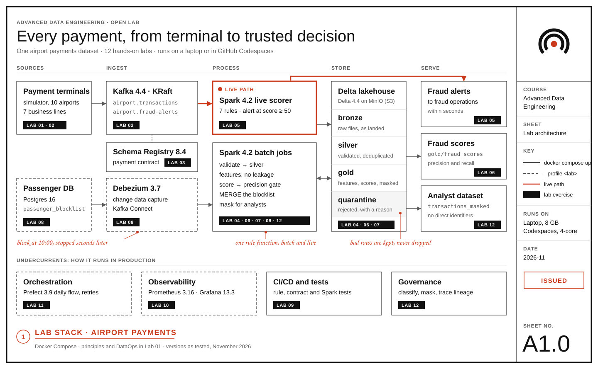

# Advanced Data Engineering Lab: Airport Payments with Kafka and Spark

<p align="center"></p>

[](https://codespaces.new/majlisofai/advanced-data-engineering-lab?quickstart=1)

- Codespaces preselects the machine size (4-core, 16 GB); smaller machines are blocked.
- The first start pulls the core images (including the ready-built Spark image), then runs `make setup`.
- Other labs pull their extra images when you run `make up LAB=NN`.

On a laptop, Docker needs at least 8 GB of memory for the core stack.

Hands-on lab for the **Advanced Data Engineering** course. Every lab uses one dataset: card payments at
an airport (tickets, duty free, currency exchange, food, car rental). Some are fraudulent. The lab builds a
pipeline that lands, validates, enriches, scores, and monitors them, all on your laptop with Docker Compose.

Adapted from the local MLOps lab *Airport Real-Time Fraud Detection*. The simulator is reused as-is. The ML
stack (Feast, MLflow, DVC, FastAPI, Evidently) is replaced by Spark jobs and transparent rules.

## Quick start

```bash
git clone https://github.com/majlisofai/advanced-data-engineering-lab.git
cd advanced-data-engineering-lab
make setup      # Python venv on the host (for the generator and the producer)
make up         # start the core stack and wait for health checks (first run pulls images: allow 10 minutes)
make urls       # print the UIs of the running services
make test       # unit tests (no Docker needed)
make smoke      # running services + topics, then Spark/Delta writes on isolated MinIO tables
```

Python 3.11+ is required (Prefect 3.9).

## Per-lab stack

`make up` starts the core stack. Labs that need more services add a Compose profile, so their images are
downloaded only when you reach that lab:

| Labs | Command | Adds | Docker memory |
|---|---|---|---|
| 01–07, 09, 12 | `make up` | (core only) | 8 GB |
| 08 CDC | `make up LAB=08` | `cdc`: Postgres, Kafka Connect + Debezium | 8 GB |
| 10 Observability | `make up LAB=10` | `monitoring`: Prometheus, Pushgateway, kafka-exporter, Grafana | 8 GB |
| 11 Orchestration | `make up LAB=11` | `orchestration`: Prefect server | 8 GB |
| all | `make up-all` | every profile | 12 GB |

```bash
make up         # Labs 01–07, 09, 12 (core only)
make up LAB=08  # Lab 08 CDC
make up LAB=10  # Lab 10 Observability
make up LAB=11  # Lab 11 Orchestration
make up-all     # every profile
```

`make pull LAB=NN` pre-downloads only those images. `make down` stops everything, all profiles. Starting a
second lab's profile keeps the first running; stop it between labs to free memory (volumes stay):

```bash
make down
```

Spark jobs push metrics to the Pushgateway only when it is running; otherwise they print a note and continue.

## What runs where

| Component | Profile | Port (host) | Role |
|---|---|---|---|
| Kafka 4.4 (KRaft) | core | 9094 | Payment events, fraud alerts |
| Kafka UI (kafbat) | core | 8080 | Browse topics and messages |
| Schema Registry | core | 8081 | Contracts for topics (Lab 03) |
| MinIO (S3 API) | core | 9000 / 9001 | Bronze, silver, gold Delta tables |
| Spark master + worker | core | 7077 / 8082 | Batch and streaming jobs (`spark/jobs/`) |
| Postgres + Debezium (Kafka Connect) | cdc | 5432 / 8083 | Blocklist changes as CDC events (Lab 08) |
| Prometheus, Pushgateway, kafka-exporter, Grafana | monitoring | 9090 / 9091 / 9308 / 3000 | Metrics and alerts (Lab 10) |
| Prefect | orchestration | 4200 | Pipeline runs, schedule, retries (Lab 11) |
| Payment terminals (simulator) | host (`make stream-produce`) | - | Sends payments to Kafka |

## Data flow

<p align="center"></p>

Every module's diagrams are in [`docs/diagrams/`](docs/diagrams/README.md).

<details><summary>Text version</summary>

```
simulator ──► data/raw/*.csv ──► bronze (MinIO) ──► silver (Delta, by day) ──► features (as of each day)
                                                                                     │
Postgres blocklist ──► Debezium ──► Kafka ──► blocklist (silver) ──────────────────► score ──► gold scores
                                                                                     │         evaluate (ground truth)
producer ──► airport.transactions ──► Spark Streaming ──► airport.fraud-alerts (Kafka)
                                                       └──► gold/stream_scores (Delta)
```

</details>

## Commands

For the full list, run:

```bash
make help
```

The main ones:

| Command | What it does |
|---|---|
| `make generate` | Simulate 60 days of payments (labels written separately) |
| `make bronze` | Upload the raw files to MinIO |
| `make silver DATE=...` | Validate and write one UTC day (omit DATE to process all bronze rows) |
| `make features` | Passenger features as of each day (no leakage) |
| `make score DATE=2026-11-18` | Score one day with the rules |
| `make evaluate` | Precision and recall against the ground truth |
| `make batch` | Everything above, in order |
| `make cdc-setup` | Create the blocklist table and register Debezium |
| `make block PASSENGER=42 REASON="stolen card"` | Block a passenger (captured as CDC) |
| `make blocklist` | MERGE CDC changes into the active blocklist (Delta) |
| `make blocklist-changes` | Read the Delta change feed of the blocklist |
| `make history` | Delta commit history of the features table |
| `make blocklist-version V=2` | The blocklist as of an earlier Delta version |
| `make scenario-normal / -drift / -attack` | Choose the live traffic pattern |
| `make stream-start` / `make stream-logs` | Start the detached scorer and check when its Kafka queries are up |
| `make stream-produce DURATION=20` | Send live payments for 20 seconds (omit DURATION to run until Ctrl+C) |
| `make alerts` | Read `airport.fraud-alerts` from Kafka |
| `make lag` | Consumer lag per group |
| `make pipeline DATE=...` | Run the daily flow once against the local Prefect server (omit DATE to use the latest silver day) |
| `make automate` | Serve the daily flow on a schedule |
| `make down` / `make clean` | Stop (keep data) / stop and delete volumes |

The same commands, ready to copy:

```bash
make generate
make bronze
make silver DATE=2026-11-18           # omit DATE to process all bronze rows
make features
make score DATE=2026-11-18
make evaluate
make batch
make cdc-setup
make block PASSENGER=42 REASON="stolen card"
make blocklist
make blocklist-changes
make history
make blocklist-version V=2
make scenario-normal
make scenario-drift
make scenario-attack
make stream-start
make stream-logs
make stream-produce DURATION=20       # omit DURATION to run until Ctrl+C
make alerts
make lag
make pipeline DATE=2026-11-18         # omit DATE to use the latest silver day
make automate
make down                             # stop, keep data
make clean                            # stop and delete volumes
```

## Fraud rules

Rules are in `spark/jobs/fraud_rules.py` and documented in the course. Each rule adds points; a payment
at score 50 or more is an alert.

| Rule | Points | Meaning |
|---|---|---|
| `AMOUNT_SPIKE` | 40 | Amount at least 4× the passenger's 30-day average |
| `NIGHT_PAYMENT` | 15 | Between 00:00 and 05:59 |
| `LAST_MINUTE` | 15 | Less than 30 minutes before departure |
| `CARD_NOT_PRESENT_HIGH_RISK` | 20 | No card present at exchange or electronics |
| `NEW_FOREIGN_PATTERN` | 10 | International payment with fewer than 2 airports in 30 days |
| `NEW_ACCOUNT` | 10 | Account younger than 30 days |
| `BLOCKED_PASSENGER` | 100 | Passenger on the blocklist |

The labels never reach the pipeline. Only `make evaluate` reads them.

## Scenarios

`make scenario-normal` (baseline), `make scenario-drift` (holiday: bigger baskets, night flights), and
`make scenario-attack` (card-testing ring: fraud rate rises several-fold). Switch them while the producer
runs; the change takes effect on the next payment:

```bash
make scenario-normal   # baseline
make scenario-drift    # holiday: bigger baskets, night flights
make scenario-attack   # card-testing ring: fraud rate rises several-fold
```

## Layout

```
spark/jobs/   Spark jobs and the rule module (mounted into the Spark containers)
src/lab/      simulator, batch generator, Kafka producer (host)
flows/        Prefect flow for the daily pipeline
cdc/          blocklist table and Debezium connector definition
monitoring/   Prometheus, alert rules, Grafana datasource
tests/        unit tests for the rules and the simulator
params.yaml   simulation size and seed
```

## Versions to check before a class

- Versions: Kafka 4.4.0 (KRaft), Schema Registry 8.4.1, Debezium 3.7.1 (`quay.io/debezium/connect`), Postgres 16,
  Spark 4.2.0 (Scala 2.13, Java 17) with Delta 4.4.1, Prometheus 3.16.0, Pushgateway 1.11.5, kafka-exporter 1.11.0,
  Grafana 13.3.1, Prefect 3.9.4, Kafka UI `kafbat/kafka-ui` v1.5.0 (maintained fork of the archived provectus image).
- Spark runs from `ghcr.io/majlisofai/advanced-data-engineering-spark:4.2.0`: JRE 17, PySpark 4.2.0, pandas/PyArrow, and the
  Kafka, S3A and Delta jars baked in (`spark/Dockerfile`). If the image cannot be pulled, Compose builds it from `spark/`.
  Delta 4.4.1 is built against Spark 4.2.0, so the image stays on 4.2.0 rather than 4.2.1.
  MinIO and its client use archived `bitnamilegacy` images: mirror these before a course; upstream images
  can disappear. Before class, pre-pull every profile (each also pulls core), then check the stack on the
  same machine/network learners will use:

  ```bash
  make pull LAB=08
  make pull LAB=10
  make pull LAB=11
  make up
  make smoke
  make batch
  ```

- Spark jobs download nothing at run time (no `--packages`), so a pulled image works offline.
- Docker memory: 8 GB for the core stack plus one lab profile; 12 GB for `make up-all`. See [VALIDATION.md](VALIDATION.md).
