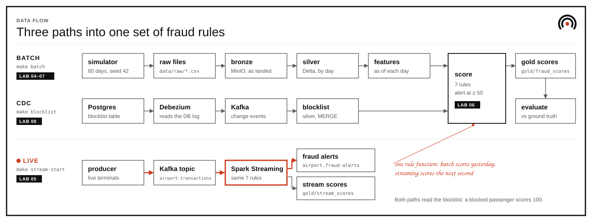

# Advanced Data Engineering Lab: Airport Payments with Kafka and Spark

<p align="center"></p>

[](https://codespaces.new/majlisofai/advanced-data-engineering-lab?quickstart=1)

- Codespaces preselects the machine size (4-core, 16 GB); smaller machines are blocked.
- The codespace is one small Alpine Linux container with uv and **no Docker**. Every service runs as a process
  in that container, managed by `scripts/codespace.sh`. Creating it runs only `uv sync --locked`: no service
  is installed and nothing starts, so it opens in a few minutes.
- Each lab starts its services with `scripts/codespace.sh up [cdc|monitoring|orchestration|all]`. The first
  run installs them (the core stack downloads about 1.3 GB: allow 10 minutes). See [Per-lab stack](#per-lab-stack).
  If an existing codespace failed at `pyspark==4.2.0`, pull the latest `main` in the lab repo and rerun `scripts/codespace.sh up`.
  Spark installs from pinned release files without querying the PyPI package index. No dev container rebuild is needed.
- Other commands: `scripts/codespace.sh down` (stop, keep data), `clean` (stop and delete data), `status`,
  `logs <service>`, `restart <service>`, `stop <service>`, `start <service>`.
- Host names (`kafka`, `minio`, `spark-master`, `postgres`, …), ports and paths (`/opt/kafka/bin`, `/opt/spark-apps`,
  `/data`, `/tmp`) are the same as in the compose containers. So a codespace command is the laptop command
  without the `docker compose exec <service>` prefix. Each step below shows a **Laptop (Docker)** and a **Codespace** block.
- UIs open from the codespace's **Ports** tab; `http://localhost:<port>` links work in both.

On a laptop, Docker needs at least 8 GB of memory for the core stack.

Hands-on lab for the **Advanced Data Engineering** course. Every lab uses one dataset: card payments at
an airport (tickets, duty free, currency exchange, food, car rental). Some are fraudulent. The lab builds a
pipeline that lands, validates, enriches, scores, and monitors them, all on your laptop with Docker Compose.

Adapted from the local MLOps lab *Airport Real-Time Fraud Detection*. The simulator is reused as-is. The ML
stack (Feast, MLflow, DVC, FastAPI, Evidently) is replaced by Spark jobs and transparent rules.

## Quick start

**Laptop (Docker)**

```bash
git clone https://github.com/majlisofai/advanced-data-engineering-lab.git
cd advanced-data-engineering-lab
uv sync --locked                                   # uv installs Python 3.12 and the locked host dependencies into .venv
docker compose up -d --wait                        # core stack, wait for health checks (first run pulls images: allow 10 minutes)
scripts/services.sh urls                           # print the UIs of the running services
PYTHONPATH=src uv run python -m pytest tests -q    # unit tests (no Docker needed)
scripts/services.sh smoke                          # running services + topics
docker compose exec -T spark-master /opt/spark/bin/spark-submit /opt/spark-apps/smoke_delta.py   # Spark/Delta writes on isolated MinIO tables
```

**Codespace** (the repo is already cloned and `uv sync --locked` has run)

```bash
scripts/codespace.sh up                            # core stack (first run installs it, about 1.3 GB: allow 10 minutes)
scripts/services.sh urls                           # print the UIs of the running services
PYTHONPATH=src uv run python -m pytest tests -q    # unit tests
scripts/services.sh smoke                          # running services + topics
/opt/spark/bin/spark-submit /opt/spark-apps/smoke_delta.py   # Spark/Delta writes on isolated MinIO tables
```

Every Spark job runs the same way: `docker compose exec -T spark-master /opt/spark/bin/spark-submit /opt/spark-apps/<job>.py [args]`.
`spark-submit` runs inside the `spark-master` container, where `spark/jobs/` is mounted at `/opt/spark-apps`.
Its settings (master URL, driver and executor memory, Delta extensions) come from `spark/conf/spark-defaults.conf`,
mounted read-only at `/opt/spark/conf/spark-defaults.conf`, so the command line carries only the job and its arguments.
In the codespace, run `/opt/spark/bin/spark-submit /opt/spark-apps/<job>.py [args]` directly: the same paths and settings file exist there.

[uv](https://docs.astral.sh/uv/getting-started/installation/) is the only host prerequisite (`brew install uv`
or `curl -LsSf https://astral.sh/uv/install.sh | sh`). It downloads the Python pinned in `.python-version` and
installs the versions locked in `uv.lock`; the Python already on your machine is not used.

## Per-lab stack

`docker compose up -d --wait` starts the core stack. Labs that need more services add a Compose profile, so their images are
downloaded only when you reach that lab:

| Labs | Command | Codespace | Adds | Docker memory |
|---|---|---|---|---|
| 01–07, 09, 12 | `docker compose up -d --wait` | `scripts/codespace.sh up` | (core only) | 8 GB |
| 08 CDC | `docker compose --profile cdc up -d --wait` | `scripts/codespace.sh up cdc` | `cdc`: Postgres, Kafka Connect + Debezium | 8 GB |
| 10 Observability | `docker compose --profile monitoring up -d --wait` | `scripts/codespace.sh up monitoring` | `monitoring`: Prometheus, Pushgateway, kafka-exporter, Grafana | 8 GB |
| 11 Orchestration | `docker compose --profile orchestration up -d --wait` | `scripts/codespace.sh up orchestration` | `orchestration`: Prefect server | 8 GB |
| all | `docker compose --profile '*' up -d --wait` | `scripts/codespace.sh up all` | every profile | 12 GB |

**Laptop (Docker)**

```bash
docker compose up -d --wait                           # Labs 01–07, 09, 12 (core only)
docker compose --profile cdc up -d --wait             # Lab 08 CDC
docker compose --profile monitoring up -d --wait      # Lab 10 Observability
docker compose --profile orchestration up -d --wait   # Lab 11 Orchestration
docker compose --profile '*' up -d --wait             # every profile
```

**Codespace**

```bash
scripts/codespace.sh up                 # Labs 01–07, 09, 12 (core only)
scripts/codespace.sh up cdc             # Lab 08 CDC
scripts/codespace.sh up monitoring      # Lab 10 Observability
scripts/codespace.sh up orchestration   # Lab 11 Orchestration
scripts/codespace.sh up all             # every profile
```

`docker compose --profile <name> pull` pre-downloads only those images. `docker compose --profile '*' down` stops everything, all profiles. Starting a
second lab's profile keeps the first running; stop it between labs to free memory (volumes stay):

**Laptop (Docker)**

```bash
docker compose --profile '*' down
```

**Codespace** (nothing to pre-pull; the first `scripts/codespace.sh up <name>` installs it)

```bash
scripts/codespace.sh down
```

Spark jobs push metrics to the Pushgateway only when it is running; otherwise they print a note and continue.

## What runs where

| Component | Profile | Port (host) | Role |
|---|---|---|---|
| Kafka 4.4 (KRaft) | core | 9094 | Payment events, fraud alerts |
| Kafka UI (kafbat) | core | 8080 | Browse topics and messages |
| Schema Registry | core | 8081 | Contracts for topics (Lab 03) |
| MinIO (S3 API) | core | 9000 / 9001 | Bronze, silver, gold Delta tables |
| Spark master + worker | core | 7077 / 8082 | Batch and streaming jobs (`spark/jobs/`) |
| Postgres + Debezium (Kafka Connect) | cdc | 5432 / 8083 | Blocklist changes as CDC events (Lab 08) |
| Prometheus, Pushgateway, kafka-exporter, Grafana | monitoring | 9090 / 9091 / 9308 / 3000 | Metrics and alerts (Lab 10) |
| Prefect | orchestration | 4200 | Pipeline runs, schedule, retries (Lab 11) |
| Payment terminals (simulator) | host (`uv run python -m lab.producer`) | - | Sends payments to Kafka |

## Data flow

<p align="center"></p>

<details><summary>Text version</summary>

```
simulator ──► data/raw/*.csv ──► bronze (MinIO) ──► silver (Delta, by day) ──► features (as of each day)
                                                                                     │
Postgres blocklist ──► Debezium ──► Kafka ──► blocklist (silver) ──────────────────► score ──► gold scores
                                                                                     │         evaluate (ground truth)
producer ──► airport.transactions ──► Spark Streaming ──► airport.fraud-alerts (Kafka)
                                                       └──► gold/stream_scores (Delta)
```

</details>

## Commands

All commands run from the repo root. `PYTHONPATH=src` lets `uv run` find the `lab` package on the host.

| Step | What it does |
|---|---|
| `uv run python -m lab.generate` | Simulate 60 days of payments (labels written separately) |
| `mc cp` to `local/bronze/` | Upload the raw files to MinIO |
| `silver_transactions.py [--date d]` | Validate and write one UTC day (omit `--date` to process all bronze rows) |
| `features_30d.py` | Passenger features as of each day (no leakage) |
| `score_batch.py [--date d]` | Score one day with the rules (default: latest) |
| `evaluate.py [--date d]` + `docker compose cp` (codespace: `cp`) | Precision and recall against the ground truth, copied to `data/reports/evaluation.json` |
| Postgres table + Debezium connector | Create the blocklist table and register Debezium |
| `INSERT INTO passenger_blocklist` | Block a passenger (captured as CDC) |
| `blocklist_from_cdc.py` | MERGE CDC changes into the active blocklist (Delta) |
| `blocklist_changes.py` | Read the Delta change feed of the blocklist |
| `history.py` | Delta commit history of the features table |
| `blocklist_version.py 2` | The blocklist as of an earlier Delta version |
| `blocked_payments.py 42` | Scored payments of one passenger |
| `mask_payments.py` | Analyst-safe dataset without direct identifiers |
| `echo attack > control/scenario` | Choose the live traffic pattern (`normal`, `drift`, `attack`) |
| `stream_fraud.py` (detached) + its log | Start the detached scorer and check when its Kafka queries are up |
| `uv run python -m lab.producer --seconds 20` | Send live payments for 20 seconds (omit `--seconds` to run until Ctrl+C) |
| `kafka-console-consumer.sh` | Read `airport.fraud-alerts` from Kafka |
| `kafka-consumer-groups.sh` | Consumer lag per group |
| `flows/pipeline.py [d]` | Run the daily flow once against the local Prefect server (omit the date to use the latest silver day) |
| `flows/pipeline.py serve` | Serve the daily flow on a schedule |
| `docker compose --profile '*' down [-v]` (codespace: `scripts/codespace.sh down` / `clean`) | Stop (keep data) / stop and delete volumes |

The same commands, ready to copy:

**Laptop (Docker)**

```bash
# Batch (Labs 01-05)
PYTHONPATH=src uv run python -m lab.generate
docker compose exec -T minio-client mc cp /data/raw/transactions.csv local/bronze/transactions/transactions.csv
docker compose exec -T minio-client mc cp /data/raw/passengers.csv local/bronze/passengers/passengers.csv
docker compose exec -T minio-client mc ls --recursive local/bronze/
docker compose exec -T spark-master /opt/spark/bin/spark-submit /opt/spark-apps/silver_transactions.py --date 2026-11-18      # omit --date to process all bronze rows
docker compose exec -T spark-master /opt/spark/bin/spark-submit /opt/spark-apps/features_30d.py
docker compose exec -T spark-master /opt/spark/bin/spark-submit /opt/spark-apps/score_batch.py --date 2026-11-18
docker compose exec -T spark-master /opt/spark/bin/spark-submit /opt/spark-apps/evaluate.py --date 2026-11-18
mkdir -p data/reports
docker compose cp spark-master:/tmp/airport-evaluation.json data/reports/evaluation.json

# Delta (Lab 06)
docker compose exec -T spark-master /opt/spark/bin/spark-submit /opt/spark-apps/history.py
docker compose exec -T spark-master /opt/spark/bin/spark-submit /opt/spark-apps/blocklist_version.py 2
docker compose exec -T spark-master /opt/spark/bin/spark-submit /opt/spark-apps/blocked_payments.py 42 --date 2026-11-18
docker compose exec -T spark-master /opt/spark/bin/spark-submit /opt/spark-apps/mask_payments.py

# CDC (Lab 08, needs --profile cdc)
docker compose exec -T kafka /opt/kafka/bin/kafka-topics.sh --bootstrap-server kafka:9092 --create --if-not-exists --topic fraud.public.passenger_blocklist --partitions 1 --replication-factor 1 --config retention.ms=-1
docker compose exec -T postgres psql -v ON_ERROR_STOP=1 -U postgres -d airport -q < cdc/blocklist.sql
uv run python -c 'import json;print(json.dumps(json.load(open("cdc/blocklist-connector.json"))["config"]))' | curl -fsS -X PUT -H "Content-Type: application/json" --data-binary @- http://localhost:8083/connectors/blocklist-connector/config
curl -fsS http://localhost:8083/connectors/blocklist-connector/status
docker compose exec -T postgres psql -U postgres -d airport -c "INSERT INTO passenger_blocklist VALUES (42, 'stolen card', (extract(epoch from clock_timestamp()) * 1000)::bigint, NULL) ON CONFLICT (passenger_id) DO UPDATE SET unblocked_at = NULL, reason = EXCLUDED.reason, blocked_at = EXCLUDED.blocked_at;"
docker compose exec -T postgres psql -U postgres -d airport -c "UPDATE passenger_blocklist SET unblocked_at = (extract(epoch from clock_timestamp()) * 1000)::bigint WHERE passenger_id = 42;"
docker compose exec -T spark-master /opt/spark/bin/spark-submit /opt/spark-apps/blocklist_from_cdc.py
docker compose exec -T spark-master /opt/spark/bin/spark-submit /opt/spark-apps/blocklist_changes.py

# Streaming (Labs 07, 09, 10)
mkdir -p control
echo normal > control/scenario
docker compose exec -d spark-master bash -c '/opt/spark/bin/spark-submit /opt/spark-apps/stream_fraud.py > /tmp/stream-fraud.log 2>&1'
docker compose exec -T spark-master tail -n 60 /tmp/stream-fraud.log
PYTHONPATH=src uv run python -m lab.producer --seconds 20     # omit --seconds to run until Ctrl+C
docker compose exec kafka /opt/kafka/bin/kafka-console-consumer.sh --bootstrap-server kafka:9092 --topic airport.fraud-alerts --from-beginning
docker compose exec kafka /opt/kafka/bin/kafka-console-consumer.sh --bootstrap-server kafka:9092 --topic airport.transactions --group lab-lag-demo --from-beginning --consumer-property enable.auto.commit=true --consumer-property auto.commit.interval.ms=1000
docker compose exec kafka /opt/kafka/bin/kafka-consumer-groups.sh --bootstrap-server kafka:9092 --all-groups --describe
docker compose exec -T spark-master pkill -f stream_fraud.py

# Orchestration (Lab 11, needs --profile orchestration)
PREFECT_API_URL=http://localhost:4200/api uv run python flows/pipeline.py 2026-11-18   # omit the date to use the latest silver day
PREFECT_API_URL=http://localhost:4200/api uv run python flows/pipeline.py serve

# Stop
docker compose --profile '*' down                                      # stop, keep data
docker compose --profile '*' down -v                                   # stop and delete volumes
rm -rf data/raw/*.csv data/reports control/scenario                    # delete generated data
```

**Codespace**

```bash
# Batch (Labs 01-05)
PYTHONPATH=src uv run python -m lab.generate
mc cp /data/raw/transactions.csv local/bronze/transactions/transactions.csv
mc cp /data/raw/passengers.csv local/bronze/passengers/passengers.csv
mc ls --recursive local/bronze/
/opt/spark/bin/spark-submit /opt/spark-apps/silver_transactions.py --date 2026-11-18      # omit --date to process all bronze rows
/opt/spark/bin/spark-submit /opt/spark-apps/features_30d.py
/opt/spark/bin/spark-submit /opt/spark-apps/score_batch.py --date 2026-11-18
/opt/spark/bin/spark-submit /opt/spark-apps/evaluate.py --date 2026-11-18
mkdir -p data/reports
cp /tmp/airport-evaluation.json data/reports/evaluation.json

# Delta (Lab 06)
/opt/spark/bin/spark-submit /opt/spark-apps/history.py
/opt/spark/bin/spark-submit /opt/spark-apps/blocklist_version.py 2
/opt/spark/bin/spark-submit /opt/spark-apps/blocked_payments.py 42 --date 2026-11-18
/opt/spark/bin/spark-submit /opt/spark-apps/mask_payments.py

# CDC (Lab 08, needs scripts/codespace.sh up cdc)
/opt/kafka/bin/kafka-topics.sh --bootstrap-server kafka:9092 --create --if-not-exists --topic fraud.public.passenger_blocklist --partitions 1 --replication-factor 1 --config retention.ms=-1
psql -v ON_ERROR_STOP=1 -U postgres -d airport -q < cdc/blocklist.sql
uv run python -c 'import json;print(json.dumps(json.load(open("cdc/blocklist-connector.json"))["config"]))' | curl -fsS -X PUT -H "Content-Type: application/json" --data-binary @- http://localhost:8083/connectors/blocklist-connector/config
curl -fsS http://localhost:8083/connectors/blocklist-connector/status
psql -U postgres -d airport -c "INSERT INTO passenger_blocklist VALUES (42, 'stolen card', (extract(epoch from clock_timestamp()) * 1000)::bigint, NULL) ON CONFLICT (passenger_id) DO UPDATE SET unblocked_at = NULL, reason = EXCLUDED.reason, blocked_at = EXCLUDED.blocked_at;"
psql -U postgres -d airport -c "UPDATE passenger_blocklist SET unblocked_at = (extract(epoch from clock_timestamp()) * 1000)::bigint WHERE passenger_id = 42;"
/opt/spark/bin/spark-submit /opt/spark-apps/blocklist_from_cdc.py
/opt/spark/bin/spark-submit /opt/spark-apps/blocklist_changes.py

# Streaming (Labs 07, 09, 10)
mkdir -p control
echo normal > control/scenario
nohup /opt/spark/bin/spark-submit /opt/spark-apps/stream_fraud.py > /tmp/stream-fraud.log 2>&1 &
tail -n 60 /tmp/stream-fraud.log
PYTHONPATH=src uv run python -m lab.producer --seconds 20     # omit --seconds to run until Ctrl+C
/opt/kafka/bin/kafka-console-consumer.sh --bootstrap-server kafka:9092 --topic airport.fraud-alerts --from-beginning
/opt/kafka/bin/kafka-console-consumer.sh --bootstrap-server kafka:9092 --topic airport.transactions --group lab-lag-demo --from-beginning --consumer-property enable.auto.commit=true --consumer-property auto.commit.interval.ms=1000
/opt/kafka/bin/kafka-consumer-groups.sh --bootstrap-server kafka:9092 --all-groups --describe
pkill -f stream_fraud.py

# Orchestration (Lab 11, needs scripts/codespace.sh up orchestration)
PREFECT_API_URL=http://localhost:4200/api uv run python flows/pipeline.py 2026-11-18   # omit the date to use the latest silver day
PREFECT_API_URL=http://localhost:4200/api uv run python flows/pipeline.py serve

# Stop
scripts/codespace.sh down                                              # stop, keep data
scripts/codespace.sh clean                                             # stop and delete data
rm -rf data/raw/*.csv data/reports control/scenario                    # delete generated data
```

Any other job in `spark/jobs/` (for example `explore_silver.py`) runs with the same spark-submit pattern.
`docker compose --profile '*' ps` lists the running containers. In the codespace, `scripts/codespace.sh status` lists the running services.

## Fraud rules

Rules are in `spark/jobs/fraud_rules.py` and documented in the course. Each rule adds points; a payment
at score 50 or more is an alert.

| Rule | Points | Meaning |
|---|---|---|
| `AMOUNT_SPIKE` | 40 | Amount at least 4× the passenger's 30-day average |
| `NIGHT_PAYMENT` | 15 | Between 00:00 and 05:59 |
| `LAST_MINUTE` | 15 | Less than 30 minutes before departure |
| `CARD_NOT_PRESENT_HIGH_RISK` | 20 | No card present at exchange or electronics |
| `NEW_FOREIGN_PATTERN` | 10 | International payment with fewer than 2 airports in 30 days |
| `NEW_ACCOUNT` | 10 | Account younger than 30 days |
| `BLOCKED_PASSENGER` | 100 | Passenger on the blocklist |

The labels never reach the pipeline. Only `evaluate.py` reads them.

## Scenarios

`normal` (baseline), `drift` (holiday: bigger baskets, night flights), and
`attack` (card-testing ring: fraud rate rises several-fold), written to `control/scenario`. Switch them while the producer
runs; the change takes effect on the next payment:

```bash
mkdir -p control
echo normal > control/scenario   # baseline
echo drift > control/scenario    # holiday: bigger baskets, night flights
echo attack > control/scenario   # card-testing ring: fraud rate rises several-fold
```

## Layout

```
scripts/      services.sh (URLs, smoke check) and codespace.sh (services as processes in a codespace, no Docker)
spark/jobs/   Spark jobs and the rule module (mounted into the Spark containers)
src/lab/      simulator, batch generator, Kafka producer (host)
flows/        Prefect flow for the daily pipeline
cdc/          blocklist table and Debezium connector definition
monitoring/   Prometheus, alert rules, Grafana datasource
tests/        unit tests for the rules and the simulator
params.yaml   simulation size and seed
spark/conf/   spark-defaults.conf for every spark-submit
```

## Versions to check before a class

- Versions: Kafka 4.4.0 (KRaft), Schema Registry 8.4.1, Debezium 3.7.1 (`quay.io/debezium/connect`), Postgres 16,
  Spark 4.2.0 (Scala 2.13, Java 17) with Delta 4.4.1, Prometheus 3.16.0, Pushgateway 1.11.5, kafka-exporter 1.11.0,
  Grafana 13.3.1, Prefect 3.9.4, Kafka UI `kafbat/kafka-ui` v1.5.0 (maintained fork of the archived provectus image).
- Spark runs from `ghcr.io/majlisofai/advanced-data-engineering-spark:4.2.0`: JRE 17, PySpark 4.2.0, pandas/PyArrow, and the
  Kafka, S3A and Delta jars baked in (`spark/Dockerfile`). If the image cannot be pulled, Compose builds it from `spark/`.
  Delta 4.4.1 is built against Spark 4.2.0, so the image stays on 4.2.0 rather than 4.2.1.
  MinIO and its client use archived `bitnamilegacy` images: mirror these before a course; upstream images
  can disappear. Before class, pre-pull every profile (each also pulls core), then check the stack on the
  same machine/network learners will use:

  **Laptop (Docker)**

  ```bash
  docker compose --profile cdc pull
  docker compose --profile monitoring pull
  docker compose --profile orchestration pull
  docker compose up -d --wait
  scripts/services.sh smoke
  docker compose exec -T spark-master /opt/spark/bin/spark-submit /opt/spark-apps/smoke_delta.py
  PYTHONPATH=src uv run python -m lab.generate
  docker compose exec -T minio-client mc cp /data/raw/transactions.csv local/bronze/transactions/transactions.csv
  docker compose exec -T minio-client mc cp /data/raw/passengers.csv local/bronze/passengers/passengers.csv
  docker compose exec -T minio-client mc ls --recursive local/bronze/
  docker compose exec -T spark-master /opt/spark/bin/spark-submit /opt/spark-apps/silver_transactions.py
  docker compose exec -T spark-master /opt/spark/bin/spark-submit /opt/spark-apps/features_30d.py
  docker compose exec -T spark-master /opt/spark/bin/spark-submit /opt/spark-apps/score_batch.py
  docker compose exec -T spark-master /opt/spark/bin/spark-submit /opt/spark-apps/evaluate.py
  mkdir -p data/reports
  docker compose cp spark-master:/tmp/airport-evaluation.json data/reports/evaluation.json
  ```

  **Codespace** (nothing to pre-pull; `scripts/codespace.sh up all` installs every profile the first time)

  ```bash
  scripts/codespace.sh up all
  scripts/services.sh smoke
  /opt/spark/bin/spark-submit /opt/spark-apps/smoke_delta.py
  PYTHONPATH=src uv run python -m lab.generate
  mc cp /data/raw/transactions.csv local/bronze/transactions/transactions.csv
  mc cp /data/raw/passengers.csv local/bronze/passengers/passengers.csv
  mc ls --recursive local/bronze/
  /opt/spark/bin/spark-submit /opt/spark-apps/silver_transactions.py
  /opt/spark/bin/spark-submit /opt/spark-apps/features_30d.py
  /opt/spark/bin/spark-submit /opt/spark-apps/score_batch.py
  /opt/spark/bin/spark-submit /opt/spark-apps/evaluate.py
  mkdir -p data/reports
  cp /tmp/airport-evaluation.json data/reports/evaluation.json
  ```

- Spark jobs download nothing at run time (no `--packages`), so a pulled image works offline.
- Docker memory: 8 GB for the core stack plus one lab profile; 12 GB for `docker compose --profile '*' up -d --wait`. See [VALIDATION.md](VALIDATION.md).
