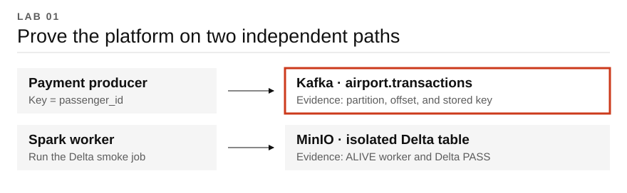

# Lab 01 · Start the platform

**Time:** 45 minutes. **Starting point:** no earlier lab required.

## Goal

Start the airport payments platform. Prove that Kafka receives a payment and that a Spark worker can run a Delta job against MinIO. These are separate checks: this lab does not start the fraud scorer.



## Codespace playbook

### 1. Open the lab environment

Use the [Codespaces button in the lab README](../../README.md) to open a 4-core, 16 GB Codespace. Wait for its creation task to finish. Run all commands from the lab repository root.

Install the locked dependencies and run the host checks:

```bash
uv sync --locked
PYTHONPATH=src uv run python -m pytest tests -q
```

**Checkpoint:** the tests finish without failures. Fix any failure before starting the services.

### 2. Start and check the core services

Start the services in the single dev container, then list their status:

```bash
scripts/codespace.sh up
scripts/codespace.sh status
```

The first start downloads runtime files. Wait for it to finish.

Check the service endpoints and Kafka topics:

```bash
scripts/services.sh smoke
```

**Checkpoint:** the check reports `ok` for Kafka UI, Schema Registry, Spark master, MinIO and both topics: `airport.transactions` and `airport.fraud-alerts`. Save this output.

### 3. Verify that Spark can write to MinIO

Open **Spark master UI** on port **8082** from the Codespaces **Ports** tab. Check that a worker is `ALIVE`.

Run the Delta smoke job. It writes to an isolated test path and removes its own test data.

```bash
/opt/spark/bin/spark-submit /opt/spark-apps/smoke_delta.py
```

**Checkpoint:** the job exits successfully and prints `PASS: Delta write, replaceWhere, time travel, MERGE and Change Data Feed`. Save the `PASS` line and the Spark worker status.

### 4. Trace one payment into Kafka

Run the producer for 10 seconds:

```bash
PYTHONPATH=src uv run python -m lab.producer --seconds 10
```

Open **Kafka UI** on port **8080** from the **Ports** tab. Select **Topics → airport.transactions → Messages**. Load the newest records and open one from your run. Compare the Kafka message key with `passenger_id` in the JSON value. They should match. Record the partition and offset so another person can identify the record.

**Checkpoint:** a record from this run is visible in Kafka. A `queued` line from the producer alone is not proof that Kafka stored it. No new fraud alert is required; you did not run the scorer.

### 5. Keep the stack for Lab 02

Leave the services running. Do not reset the stack, delete data, or remove volumes between exercises.

## Laptop (Docker) playbook

Complete the Codespace steps above with the following laptop-specific setup and command substitutions. Install `uv`, allocate at least 8 GB to Docker, and clone the lab:

```bash
git clone https://github.com/majlisofai/advanced-data-engineering-lab.git
cd advanced-data-engineering-lab
```

In Step 1, run the same `uv sync` and test commands. In Step 2, start and check the Compose stack:

```bash
docker compose up -d --wait
docker compose ps -a
scripts/services.sh smoke
```

`kafka-init` and `minio-init` can finish and exit with code 0; they are one-time setup tasks.

In Step 3, open [localhost:8082](http://localhost:8082) and run the Delta smoke job inside Spark:

```bash
docker compose exec -T spark-master /opt/spark/bin/spark-submit /opt/spark-apps/smoke_delta.py
```

In Step 4, use [localhost:8080](http://localhost:8080). Step 5 and the evidence requirements are unchanged.

## Output evidence to submit

Submit one `lab-01-evidence.md` with your environment (Codespace or laptop), the date of your run, and the following evidence. Paste the actual output or attach screenshots; do not include credentials.

| Evidence | What it must show |
|---|---|
| Service checks | Output from `scripts/services.sh smoke`, including both Kafka topics |
| Spark and MinIO | The `ALIVE` worker in Spark master and the `PASS` line from the Delta smoke job |
| Kafka payment | Topic `airport.transactions`, partition, offset, key, and the matching `passenger_id` from one new record |

In one sentence, explain what the Kafka record proves that the producer's `queued` output does not.

Next: [Lab 02 · Kafka keys, groups, and lag](lab-02-kafka-basics.md).
