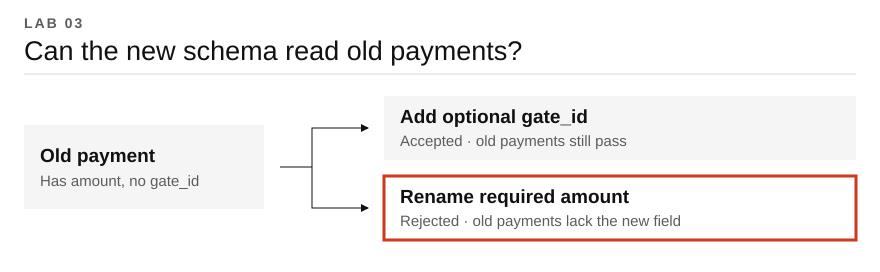

# Lab 03 · The payment contract

**Time:** 45 minutes. **Starting point:** [Lab 02 complete](lab-02-kafka-basics.md), with the core stack running. Run all commands in one terminal from the lab repository root. The commands are the same in Codespaces and on a laptop.

## Goal

Validate payment records against the JSON Schema. Use Schema Registry to accept a backward-compatible change and reject a breaking change. Backward compatibility here means the new schema can read payments written under the previous schema.



## Playbook

### 1. Read the existing contract

Open [`schemas/payment_event.json`](../../schemas/payment_event.json). Find the `required` array, the airport enumeration, the positive `amount` constraint, and the rule that forbids extra fields. Check why `scenario` is recognized but optional.

### 2. Check a valid and an invalid payment

Run the contract tests. The tests check generated payment records and confirm that an unknown airport is rejected.

```bash
PYTHONPATH=src uv run --locked python -m pytest tests/test_contract.py -q
```

Change only the `airport` value in a copy of one generated payment. Compare the validation result for each copy. This does not edit the contract, change the tests, or send a bad payment to Kafka.

```bash
PYTHONPATH=src uv run --locked python - <<'PY'
import json
from pathlib import Path

import numpy as np
import pandas as pd
from jsonschema import ValidationError, validate
from lab.simulation import make_passengers, make_transactions

schema = json.loads(Path("schemas/payment_event.json").read_text())
times = pd.date_range("2024-03-01T00:00:00Z", periods=1)
event = make_transactions(make_passengers(200, seed=9), times, np.random.default_rng(9), "normal").to_dict("records")[0]
event["event_timestamp"] = event["event_timestamp"].isoformat()
del event["is_fraud"]
validate(event, schema)
print(f"Accepted generated airport: {event['airport']}")
try:
    validate({**event, "airport": "XXX"}, schema)
except ValidationError as error:
    print(f"Rejected airport XXX: {error.message}")
else:
    raise SystemExit("Unexpected result: XXX passed the contract")
PY
```

**Checkpoint:** the tests pass, the original event validates, and `XXX` is rejected by the airport enumeration. Save both results.

### 3. Register the baseline on an isolated subject

Use a new training subject for each run. It is separate from `airport.transactions-value` so you do not change the pipeline's registry state. Keep the variables and function available for the remaining steps.

```bash
REG=http://localhost:8081
WORK=$(mktemp -d)
SUB="lab03-payment-contract-${WORK##*/}-value"
H='Content-Type: application/vnd.schemaregistry.v1+json'
schema_body() {
  python3 -c 'import json, pathlib, sys; print(json.dumps({"schemaType": "JSON", "schema": pathlib.Path(sys.argv[1]).read_text()}))' "$1"
}
printf 'Training subject: %s\n' "$SUB"
curl -fsS -X PUT -H "$H" -d '{"compatibility":"BACKWARD"}' "$REG/config/$SUB"
schema_body schemas/payment_event.json | curl -fsS -H "$H" --data-binary @- "$REG/subjects/$SUB/versions"
curl -fsS "$REG/subjects/$SUB/versions"
```

**Checkpoint:** the registration returns an `id`. The version list contains only `1`. A schema ID identifies a schema; the version is its sequence within this subject. Record the subject, ID, and version.

### 4. Add an optional field

Create a copy of the baseline with `gate_id` added to `properties`, not to `required`. The original contract stays unchanged.

```bash
python3 - "$WORK" <<'PY'
import json
import sys
from pathlib import Path

work = Path(sys.argv[1])
schema = json.loads(Path("schemas/payment_event.json").read_text())
schema["properties"]["gate_id"] = {"type": ["string", "null"]}
(work / "payment-v2.json").write_text(json.dumps(schema))
PY
schema_body "$WORK/payment-v2.json" | curl -fsS -H "$H" --data-binary @- "$REG/compatibility/subjects/$SUB/versions/latest?verbose=true"
```

**Checkpoint:** continue only if `is_compatible` is `true`. Old payments lack `gate_id`, but it is optional. Register the candidate and check the subject versions:

```bash
schema_body "$WORK/payment-v2.json" | curl -fsS -H "$H" --data-binary @- "$REG/subjects/$SUB/versions"
curl -fsS "$REG/subjects/$SUB/versions"
```

Save the compatibility response, the new schema ID, and the version list. The list should now be `[1,2]`.

### 5. Try to rename a required field

Create another copy that renames `amount` in both `properties` and `required`. The registry checks this candidate against version 2.

```bash
python3 - "$WORK" <<'PY'
import json
import sys
from pathlib import Path

work = Path(sys.argv[1])
schema = json.loads((work / "payment-v2.json").read_text())
schema["properties"]["amount_eur_value"] = schema["properties"].pop("amount")
required = schema["required"]
required[required.index("amount")] = "amount_eur_value"
(work / "payment-breaking.json").write_text(json.dumps(schema))
PY
schema_body "$WORK/payment-breaking.json" | curl -fsS -H "$H" --data-binary @- "$REG/compatibility/subjects/$SUB/versions/latest?verbose=true"
schema_body "$WORK/payment-breaking.json" | curl -sS -w '\nHTTP %{http_code}\n' -H "$H" --data-binary @- "$REG/subjects/$SUB/versions"
curl -fsS "$REG/subjects/$SUB/versions"
```

**Checkpoint:** the compatibility check returns `false`, registration returns HTTP `409`, and the version list remains `[1,2]`. Keep the stack running for Lab 04. This exercise does not change the tracked schema or any production subject.

## Output evidence to submit

Submit one `lab-03-evidence.md` with your environment, training subject, and actual command output.

| Evidence | What it must show |
|---|---|
| Local validation | Passing contract tests, the accepted generated airport, and the rejection of `XXX`. |
| Versions 1 and 2 | Both registration IDs, `is_compatible: true` for the optional field, and `[1,2]`. |
| Rejected candidate | `is_compatible: false` with the registry's reason, HTTP `409`, and the unchanged version list. |

In two sentences, explain why an old payment still fits version 2 but fails the candidate with the renamed amount field. A registry response checks schema evolution; it does not prove that Kafka validates every message sent by the lab's plain JSON producer.

Next: [Lab 04 · Batch silver payments](lab-04-spark-batch.md).
