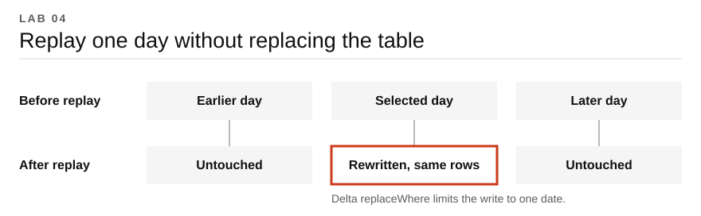

# Lab 04 · Replay a day of silver payments

**Time:** 60 minutes. **Starting point:** [Lab 03 complete](lab-03-payment-contract.md), with the core stack running. Run commands from the lab repository root. Use one terminal for the commands and keep the Spark UI open separately.

## Goal

Land the historical CSVs in bronze and build a date-partitioned Delta table in silver. Replay one UTC day and prove that no rows change on that day or any other day when the input is unchanged.



## Playbook

### 1. Generate and land the batch input

Stop any other batch pipeline actions before starting. Generate the baseline once. If you already completed this step on this stack, reuse the same raw files and bronze objects: the generator uses the current UTC day, so rerunning it later can change the date range. Do not replace an existing clean baseline with test or quarantine fixtures.

```bash
PYTHONPATH=src uv run --locked python -m lab.generate
awk 'END {print "Transaction rows:", NR-1}' data/raw/transactions.csv
head -n 1 data/raw/transactions.csv
head -n 1 data/raw/labels.csv
```

**Codespaces**

```bash
spark04() { /opt/spark/bin/spark-submit "$@"; }
mc04() { mc "$@"; }
```

**Compose only — use these functions instead**

```bash
spark04() { docker compose exec -T spark-master /opt/spark/bin/spark-submit "$@"; }
mc04() { docker compose exec -T minio-client mc "$@"; }
```

Copy the two input files to MinIO. Keep `labels.csv` on the mounted local data path for evaluation in Lab 06.

```bash
mc04 cp /data/raw/transactions.csv local/bronze/transactions/transactions.csv
mc04 cp /data/raw/passengers.csv local/bronze/passengers/passengers.csv
mc04 ls --recursive local/bronze/
```

**Checkpoint:** the default generator produces 72,000 transaction rows, excluding the header. The two CSVs appear in bronze; the ground truth does not. Explain why the scorer must not see `is_fraud`.

### 2. Build silver and inspect the Spark write

In Codespaces, open **Ports → 4040 → Open in Browser** while the job runs. Forward port `4040` first if it is not listed. On Compose, open <http://localhost:4040>. Start the job and refresh the application UI when it comes up.

```bash
mkdir -p data/reports
spark04 /opt/spark-apps/silver_transactions.py 2>&1 | tee data/reports/lab04-build.log
mc04 ls local/silver/transactions/ | head
```

**Checkpoint:** save the `bronze=… silver=… rejected=…` line. A clean first run should accept all generated rows and reject none. Look for `_delta_log/` and `event_date=…/` directories. In the Spark UI, record a stage ID and task count. Open the silver write in **SQL / DataFrame** and note one physical plan operator. If the UI closes before you inspect it, use the replay in Step 4.

### 3. Explore the Delta snapshot

Create a read-only Spark probe under `data/reports/`, which is available to the driver as `/opt/spark-data/reports/` in both environments. The first run records the table version and proposes the most recent day for replay.

```bash
cat > data/reports/lab04-inspect.py <<'PY'
import sys
sys.path.insert(0, "/opt/spark-apps")
from delta.tables import DeltaTable
from pyspark.sql import functions as F
from common import SILVER_TRANSACTIONS, read_delta, session

spark = session("lab04_inspect")
path = SILVER_TRANSACTIONS
history = DeltaTable.forPath(spark, path).history(1)
latest = history.first()
current = read_delta(spark, path)
days = current.groupBy("event_date").count().orderBy("event_date")
print(f"VERSION={latest.version}")
print(f"DAY={days.agg(F.max('event_date')).first()[0]}")
print(f"Day partitions: {days.count()}")
days.show(5)
current.groupBy("merchant_category").count().orderBy(F.desc("count")).show()
if len(sys.argv) == 3:
    version, day = int(sys.argv[1]), sys.argv[2]
    if latest.version != version + 1:
        raise SystemExit("Expected exactly one commit since the baseline; check your replay and other writers.")
    history.select("version", "operation", "operationParameters").show(truncate=False)
    previous = spark.read.format("delta").option("versionAsOf", version).load(path)
    for scope, condition in [("replayed", F.col("event_date") == day),
                             ("other", F.col("event_date") != day)]:
        before, after = previous.filter(condition), current.filter(condition)
        removed = before.exceptAll(after).count()
        added = after.exceptAll(before).count()
        print(f"{scope}: before={before.count()} after={after.count()} removed={removed} added={added}")
        if removed or added:
            raise SystemExit(f"Replay changed rows in {scope}")
spark.stop()
PY
spark04 /opt/spark-data/reports/lab04-inspect.py 2>&1 | tee data/reports/lab04-before.log
```

**Checkpoint:** record the first five day counts, the total number of dates, and the leading merchant category. A fresh table built from the default dataset should span 60 UTC dates. An existing table can retain dates from earlier runs.

### 4. Replay one day and compare versions

Use the baseline version and date from the probe. Rebuild just that date with the same bronze data. Do not run another writer between the baseline and the comparison.

```bash
VERSION=$(awk -F= '/^VERSION=/{print $2}' data/reports/lab04-before.log)
DAY=$(awk -F= '/^DAY=/{print $2}' data/reports/lab04-before.log)
printf 'Baseline version=%s; replay date=%s\n' "$VERSION" "$DAY"
```

Check that both values printed before running the replay and post-replay probe.

```bash
spark04 /opt/spark-apps/silver_transactions.py --date "$DAY" 2>&1 | tee data/reports/lab04-replay.log
spark04 /opt/spark-data/reports/lab04-inspect.py "$VERSION" "$DAY" 2>&1 | tee data/reports/lab04-after.log
```

**Checkpoint:** the replay summary covers only the selected day. The new Delta commit lists an overwrite predicate for that date. The row-level comparison should report zero additions and removals both for the replayed day and for all other days. Equal counts alone would not detect a changed value.

Read [`silver_transactions.py`](../../spark/jobs/silver_transactions.py) and `write_delta_partitions` in [`common.py`](../../spark/jobs/common.py). Find the transaction-key deduplication and `replaceWhere` predicate. Keep the stack, bronze and silver for Lab 05.

## Output evidence to submit

Submit one `lab-04-evidence.md` with your environment and actual observations.

| Evidence | What it must show |
|---|---|
| Bronze | Raw row count and the two landed object keys; why labels stay separate. |
| Silver | Build summary, first five day counts, total dates, and leading merchant category. |
| Spark UI | Stage ID and task count, plus an operator from the write plan. |
| Replay | Selected date, rerun summary, before/after versions, overwrite predicate, and both row comparisons. |

Explain why append could duplicate rows and why an unrestricted overwrite could remove the other dates. Distinguish a new Delta commit from a change to the logical data.

Next: [Lab 05 · Real-time fraud scoring](lab-05-spark-streaming.md).
