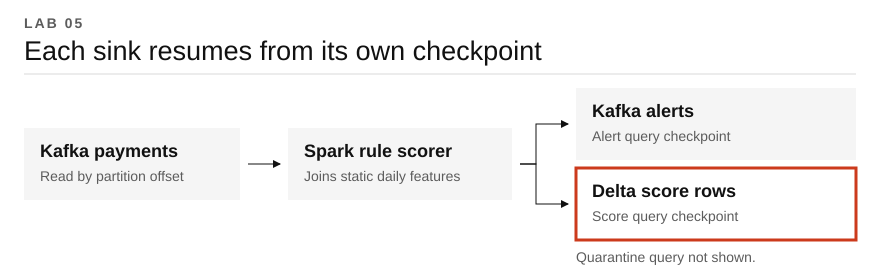

# Lab 05 · Measure live fraud decisions

**Time:** 75 minutes. **Starting point:** [Lab 04 complete](lab-04-spark-batch.md), with core services running. Open two terminals at the lab repository root: **A** for Spark, **B** for traffic and evidence. Use your own stack. Stop other scorers and producers, and do not run the dashboard's streaming action concurrently.

## Goal

Score payments from Kafka with Spark Structured Streaming. Compare alerts for normal, drift, and attack traffic. Measure decision latency and demonstrate recovery from a checkpoint without deleting any existing data.



## Playbook

### 1. Build the static features and prepare the two terminals

In **A**, define `spark05` and `mc05`. Define the same functions in **B** for later checks.

**Codespaces**

```bash
spark05() { /opt/spark/bin/spark-submit "$@"; }
mc05() { mc "$@"; }
```

**Compose only — use these functions instead**

```bash
spark05() { docker compose exec -T spark-master /opt/spark/bin/spark-submit "$@"; }
mc05() { docker compose exec -T minio-client mc "$@"; }
```

In **A**, build features and write the dashboard's existing stream supervisor to the mounted reports directory. This uses the same scorer and checkpoints as the dashboard. The supervisor waits for all three queries to initialize and drains them before stopping.

```bash
spark05 /opt/spark-apps/features_30d.py
mkdir -p data/reports
RUN05=$(mktemp -d data/reports/lab05.XXXXXXXX)
printf '%s\n' "$RUN05" > data/reports/lab05-current.txt
PYTHONPATH=src uv run --locked python -c 'from lab.dashboard import stream_source; print(stream_source())' > "$RUN05/driver.py"
APP05=/opt/spark-data/reports/${RUN05##*/}
spark05 --conf spark.sql.streaming.stopTimeout=15s "$APP05/driver.py" "$APP05" 2>&1 | tee "$RUN05/first.log"
```

**Checkpoint:** the feature build reports as-of dates. Wait for `features as of …` and `LAB_DASHBOARD_STREAM_READY` before sending traffic. The scorer broadcasts the latest feature snapshot, uses `mapInPandas` for the rules, and does not keep per-passenger streaming state. If it fails, read the first Spark error; confirm the feature job finished and the single Spark worker is alive at port `8082`.

### 2. Measure one minute of each scenario

In **B**, prepare a read-only Kafka probe. It snapshots each partition's next offset. It can also fetch just the records between two snapshots without committing offsets. This excludes older alerts and matches each new alert to the scenario of its payment by `transaction_id`, even when scoring lags.

```bash
RUN05=$(cat data/reports/lab05-current.txt)
cat > "$RUN05/kafka_evidence.py" <<'PY'
import json
import sys
import time
from collections import Counter
from pathlib import Path

from confluent_kafka import KafkaException, TopicPartition
from lab.dashboard import kafka_consumer, watermarks

payments, alerts = "airport.transactions", "airport.fraud-alerts"
root, mode, name = Path(sys.argv[1]), sys.argv[2], sys.argv[3]

def snapshot(label):
    return json.loads((root / f"{label}.offsets.json").read_text())

def read_range(consumer, topic, start, end):
    low, high = start[topic], end[topic]
    pending = {int(p): high[p] for p in high if high[p] > low[p]}
    if not pending:
        return []
    consumer.assign([TopicPartition(topic, p, low[str(p)]) for p in pending])
    rows = []
    deadline = time.monotonic() + 30
    while pending and time.monotonic() < deadline:
        msg = consumer.poll(0.5)
        if msg is None:
            continue
        if msg.error():
            raise KafkaException(msg.error())
        p, offset = msg.partition(), msg.offset()
        if p in pending:
            if offset < pending[p]:
                rows.append(json.loads(msg.value()))
            if offset >= pending[p] - 1:
                pending.pop(p)
    if pending:
        raise SystemExit(f"Kafka read did not reach the saved end offsets: {pending}")
    return rows

with kafka_consumer() as consumer:
    if mode == "snapshot":
        offsets = {t: {p: high for p, (_, high) in watermarks(consumer, t).items()}
                   for t in (payments, alerts)}
        (root / f"{name}.offsets.json").write_text(json.dumps(offsets, indent=2))
        print(name, offsets)
    else:
        end = snapshot(name)
        groups = [("normal", "before", "normal"), ("drift", "normal", "drift"),
                  ("attack", "drift", "attack")]
        if name == "after-restart":
            groups += [("offline", "first-drained", "offline"),
                       ("resumed", "offline", "resumed")]
        cohorts, scenarios = [], {}
        for label, start, stop in groups:
            rows = read_range(consumer, payments, snapshot(start), snapshot(stop))
            ids = [row["transaction_id"] for row in rows]
            expected = sum(snapshot(stop)[payments][p] - high
                           for p, high in snapshot(start)[payments].items())
            if len(ids) != expected or len(set(ids)) != expected or not ids:
                raise SystemExit(f"Unexpected payment count for {label}: {len(ids)} vs {expected}")
            observed = Counter(row["scenario"] for row in rows)
            if set(observed) != {label if label in {"normal", "drift", "attack"} else "normal"}:
                raise SystemExit(f"Unexpected scenarios for {label}: {observed}")
            scenarios.update({txn: label for txn in ids})
            cohorts.extend({"scenario": label, "transaction_id": txn} for txn in ids)
            print(label, "payments from Kafka offset delta:", expected)
        grouped = {label: [] for label, _, _ in groups}
        for alert in read_range(consumer, alerts, snapshot("before"), end):
            label = scenarios.get(alert["transaction_id"])
            if label:
                grouped[label].append(alert)
        for label, rows in grouped.items():
            print(label, "Kafka alerts:", len(rows), "unique alerted IDs:",
                  len({row["transaction_id"] for row in rows}))
            if rows:
                print(label, "sample:", json.dumps(rows[0]))
        (root / f"{name}.ids.jsonl").write_text("".join(json.dumps(row) + "\n" for row in cohorts))
PY
kafka05() { PYTHONPATH=src uv run --locked python "$RUN05/kafka_evidence.py" "$RUN05" "$@"; }
traffic05() { TRANSACTIONS_PER_SECOND=5 PYTHONPATH=src uv run --locked python -m lab.producer --seconds "$1"; }
mkdir -p control
kafka05 snapshot before
```

Keep this block running to completion in **B**. It uses one 60-second window per scenario at the same configured producer rate. It flushes the producer before taking each snapshot.

```bash
for scenario in normal drift attack; do
  printf '%s\n' "$scenario" > control/scenario
  traffic05 60 > "$RUN05/$scenario.producer.log" 2>&1 || break
  kafka05 snapshot "$scenario" || break
done
printf 'normal\n' > control/scenario
```

While traffic runs, open **Ports → 4040 → Open in Browser** in Codespaces (forward `4040` if needed). On Compose, open <http://localhost:4040>. In **Structured Streaming**, capture a completed batch with input rows and duration. Check that all three snapshots exist and the producer logs show the intended modes. The simulator changes the traffic mix in `drift` without raising the fraud probability. The synthetic `attack` mode raises that probability. Neither producer mode sends labels.

### 3. Drain and compare alerts and latency

Ask the supervisor to finish all available Kafka input. Wait in **A** for `Stream progress:` and for the command to return. Do not stop the job with Ctrl+C while it is processing the experiment.

```bash
touch "$RUN05/drain"
```

In **B**, capture the drained Kafka and Delta checkpoint state. Run the comparison probe to report scenario counts and representative alerts.

```bash
kafka05 snapshot first-drained
kafka05 compare first-drained | tee "$RUN05/first-kafka.txt"
mc05 cat local/checkpoints/fraud_stream_scores/metadata | tee "$RUN05/first-checkpoint-id.txt"
mc05 ls local/checkpoints/fraud_stream_scores/commits/ | tee "$RUN05/first-commits.txt"
first_batch=$(awk '$NF ~ /^[0-9]+$/ {print $NF}' "$RUN05/first-commits.txt" | sort -n | tail -n 1)
mc05 cat "local/checkpoints/fraud_stream_scores/offsets/$first_batch" | tee "$RUN05/first-committed-offsets.txt"
```

For these one-minute producer windows, each cohort's Kafka alert count is its alerts per producer minute. Compare alert counts and the fraction of produced payments that alert. If a cohort has no alerts, report zero; do not substitute a historical sample. Decode one alert using the point values in [`fraud_rules.py`](../../spark/jobs/fraud_rules.py).

In **B**, create a Spark probe for the same payment IDs. Compare Kafka payments with distinct and total Delta score rows; measure average and approximate p95 event-to-score latency in seconds. This measures the Delta score timestamp, not alert delivery to an operator.

```bash
cat > "$RUN05/latency.py" <<'PY'
import sys
sys.path.insert(0, "/opt/spark-apps")
from pyspark.sql import functions as F
from common import GOLD_STREAM_SCORES, read_delta, session

spark = session("lab05_latency")
ids = spark.read.schema("scenario string, transaction_id string").json(sys.argv[1])
scored = (read_delta(spark, GOLD_STREAM_SCORES)
          .select("transaction_id", "event_timestamp", "scored_at")
          .withColumn("seconds", F.col("scored_at").cast("double") - F.col("event_timestamp").cast("double")))
(ids.join(scored, "transaction_id", "left").groupBy("scenario").agg(
    F.countDistinct("transaction_id").alias("kafka_payments"),
    F.countDistinct(F.when(F.col("scored_at").isNotNull(), F.col("transaction_id"))).alias("distinct_scored"),
    F.count("scored_at").alias("score_rows"),
    F.round(F.avg("seconds"), 3).alias("avg_s"),
    F.round(F.percentile_approx("seconds", 0.95), 3).alias("p95_s")
).orderBy("scenario").show(truncate=False))
spark.stop()
PY
APP05=/opt/spark-data/reports/${RUN05##*/}
spark05 "$APP05/latency.py" "$APP05/first-drained.ids.jsonl" 2>&1 | tee "$RUN05/first-latency.log"
```

**Checkpoint:** after draining, compare `kafka_payments`, `distinct_scored`, and `score_rows` for each scenario. Investigate any mismatch before proceeding. Compare each latency with a two-second decision budget; note that Spark's batch duration is not the same as the event-to-score measurement.

### 4. Prove restart catches up without replaying the earlier cohorts

With **A** stopped, send a 15-second normal burst in **B**. This is the offline cohort. Check that its snapshot shows advanced payment offsets.

```bash
traffic05 15 > "$RUN05/offline.producer.log" 2>&1
kafka05 snapshot offline
```

Restart in **A** using the same Spark job and checkpoint paths. Remove only the supervisor's temporary drain signal, not any Spark checkpoint.

```bash
rm -f "$RUN05/drain"
spark05 --conf spark.sql.streaming.stopTimeout=15s "$APP05/driver.py" "$APP05" 2>&1 | tee "$RUN05/restart.log"
```

Wait again for `LAB_DASHBOARD_STREAM_READY`. The supervisor has processed the offline backlog before printing this line. Send a second burst in **B**; this supplies new batches for the supervisor's progress report. Drain and wait for **A** to return.

```bash
traffic05 15 > "$RUN05/resumed.producer.log" 2>&1
kafka05 snapshot resumed
touch "$RUN05/drain"
```

In **B**, capture the new checkpoint commits and rerun the comparison over all five cohorts.

```bash
kafka05 snapshot after-restart
kafka05 compare after-restart | tee "$RUN05/restart-kafka.txt"
mc05 cat local/checkpoints/fraud_stream_scores/metadata | tee "$RUN05/restart-checkpoint-id.txt"
mc05 ls local/checkpoints/fraud_stream_scores/commits/ | tee "$RUN05/restart-commits.txt"
last_batch=$(awk '$NF ~ /^[0-9]+$/ {print $NF}' "$RUN05/restart-commits.txt" | sort -n | tail -n 1)
mc05 cat "local/checkpoints/fraud_stream_scores/offsets/$last_batch" | tee "$RUN05/restart-committed-offsets.txt"
diff -u "$RUN05/first-checkpoint-id.txt" "$RUN05/restart-checkpoint-id.txt"
spark05 "$APP05/latency.py" "$APP05/after-restart.ids.jsonl" 2>&1 | tee "$RUN05/restart-latency.log"
```

**Checkpoint:** the checkpoint ID is unchanged and the commit list has advanced. Compare the payment offsets in the last committed batches with the Kafka next offsets in the `first-drained` and `after-restart` snapshots. Both new cohorts have scores; the three original cohorts have no additional Delta score rows. The Kafka alert sink is at least once, not exactly once: compare total and unique alerted IDs and explain why a retry could publish an alert twice. Keep the checkpoints and core services running. Leave the scorer and producer stopped and `control/scenario` set to `normal`.

## Output evidence to submit

Submit one `lab-05-evidence.md` with your environment and actual observations.

| Evidence | What it must show |
|---|---|
| Live query | Feature snapshot date and a screenshot or excerpt of a completed Streaming batch, including input rows and duration. |
| Scenarios | Payment and alert counts for each one-minute window, alerts per minute, examples for normal and attack where present, and one score explained by its rules. |
| Latency | Kafka and Delta counts plus average and p95 seconds for the three live cohorts. Discuss the two-second budget and why alert rate is not fraud rate. |
| Recovery | Payment offsets for the offline burst, unchanged checkpoint ID, advancing commit numbers, and Delta score counts for all five cohorts before/after where applicable. |

Explain why `startingOffsets=latest` applies to a fresh query, not a restart from the recorded offsets. Name the key you would use to deduplicate Kafka alerts downstream.

Next: [Lab 06 · Delta tables, features, and leakage](lab-06-lakehouse.md).
