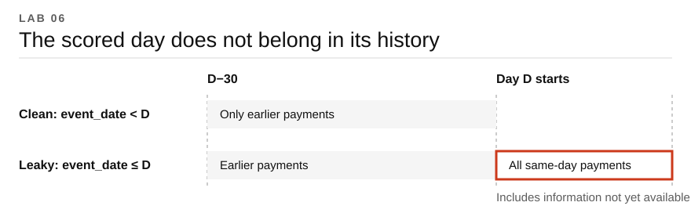

# Lab 06 · Measure leakage and choose an alert threshold

**Time:** 60 minutes. **Starting point:** [Lab 05 complete](lab-05-spark-streaming.md), with its scorer stopped. Keep the clean bronze, silver, and local labels from [Lab 04](lab-04-spark-batch.md). Run commands in one terminal from the lab repository root. Do not run other writers or rerun the generator during this lab.

## Goal

Build point-in-time Delta features, score a fixed day, and evaluate only after scoring. Compare clean and deliberately leaky features at the same threshold. Then vary only the threshold and explain the trade-off.



## Codespace playbook

### 1. Build clean features and record the Delta version

Read [`features_30d.py`](../../spark/jobs/features_30d.py). Find the history join with `event_date < as_of` and the lower bound `date_sub(as_of, 30)`. For day D, the 30-day average uses dates D−30 through D−1, not D. The seven-day count applies a shorter bound to the same join.

```bash
spark06() { /opt/spark/bin/spark-submit "$@"; }
mc06() { mc "$@"; }
copy06() { cp /tmp/airport-evaluation.json "$1"; }
```

Use the day recorded by Lab 04. Create a fresh local evidence directory and use its name as an isolated object prefix for the leakage experiment.

```bash
DAY=$(awk -F= '/^DAY=/{print $2}' data/reports/lab04-before.log)
printf 'Fixed scoring day: %s\n' "$DAY"
RUN06=$(mktemp -d data/reports/lab06.XXXXXXXX)
ID06=${RUN06##*/}
APP06=/opt/spark-data/reports/$ID06
spark06 /opt/spark-apps/features_30d.py 2>&1 | tee "$RUN06/features.log"
spark06 /opt/spark-apps/history.py 2>&1 | tee "$RUN06/history.log"
mc06 ls local/gold/passenger_features/ | head -n 6
```

**Checkpoint:** `DAY` is nonempty. Save the as-of date count, a partition key, and the latest feature table version and operation from `DESCRIBE HISTORY`. A Delta version identifies a committed snapshot. The as-of date identifies the feature window used for a prediction; it is not the Delta version.

### 2. Score the fixed day and evaluate the clean baseline

Use the same day for both jobs. The scorer joins features at `as_of = DAY` and writes batch scores at the default threshold of 50. Only the evaluation job joins `labels.csv` by `transaction_id`.

```bash
spark06 /opt/spark-apps/score_batch.py --date "$DAY" 2>&1 | tee "$RUN06/clean-score.log"
spark06 /opt/spark-apps/evaluate.py --date "$DAY"
copy06 "$RUN06/clean-50.json"
cat "$RUN06/clean-50.json"
```

**Checkpoint:** the scored date and evaluated date match. Check that evaluated payments match the scored payments and that the alert counts agree. Record precision (true alerts divided by all alerts) and recall (true alerts divided by all labeled frauds). If a denominator is zero, note it: the job reports zero using a denominator floor of one.

### 3. Change just the point-in-time boundary in isolated tables

Run a copy of the feature job with `event_date <= as_of`. This includes the payment itself and later payments from the same day. The wrapper uses the existing scoring and evaluation scripts against run-specific paths. It does not edit tracked files or replace shared clean features, baseline scores, or the baseline evaluation file. The reported Spark scoring summary and the evaluation JSON are written to your evidence log.

```bash
cat > "$RUN06/leak_experiment.py" <<'PY'
import os
import runpy
import sys
from pathlib import Path

jobs = Path("/opt/spark-apps")
sys.path.insert(0, str(jobs))
import common

job, day, run = sys.argv[1:]
common.GOLD_FEATURES = f"s3a://gold/lab06/{run}/leaky_features/"
common.GOLD_SCORES = f"s3a://gold/lab06/{run}/leaky_scores/"
common.EVALUATION_REPORT = f"/tmp/{run}-leaky-50.json"
os.environ.pop("PUSHGATEWAY_URL", None)
if job == "features_30d":
    script = jobs / "features_30d.py"
    original = 'F.col("event_date") < F.col("as_of")'
    leak = 'F.col("event_date") <= F.col("as_of")'
    code = script.read_text()
    if code.count(original) != 1:
        raise SystemExit("Could not locate a unique strict point-in-time predicate")
    print(f"One change: {original} -> {leak}", flush=True)
    exec(compile(code.replace(original, leak), str(script), "exec"), {"__name__": "__main__"})
elif job in {"score_batch", "evaluate"}:
    script = jobs / f"{job}.py"
    sys.argv = [str(script), "--date", day]
    runpy.run_path(str(script), run_name="__main__")
else:
    raise SystemExit(f"Unknown job: {job}")
PY
spark06 "$APP06/leak_experiment.py" features_30d "$DAY" "$ID06" 2>&1 | tee "$RUN06/leaky-features.log"
spark06 "$APP06/leak_experiment.py" score_batch "$DAY" "$ID06" 2>&1 | tee "$RUN06/leaky-score.log"
spark06 "$APP06/leak_experiment.py" evaluate "$DAY" "$ID06" 2>&1 | tee "$RUN06/leaky-evaluation.log"
```

**Checkpoint:** the leaky comparison uses the same day, labels, and threshold as the clean one. Record both reports, even if a metric does not change. Explain how including a large payment in its own average can lower its `amount_ratio`, and how later same-day payments can change what the rules see. Leaky metrics can move in either direction; they are not a valid estimate of live performance.

### 4. Sweep thresholds without changing the score or the feature snapshot

Read [`fraud_rules.py`](../../spark/jobs/fraud_rules.py). The threshold changes `is_alert`, not the points assigned to a payment. Reclassify the persisted **clean** scores at 30, 50 and 70, and compare them against the same fixed-day labels. This is equivalent to rescoring at each threshold because the underlying rule scores do not depend on it. The probe does not write a table.

```bash
cat > "$RUN06/thresholds.py" <<'PY'
import sys
sys.path.insert(0, "/opt/spark-apps")
from pyspark.sql import functions as F
from common import GOLD_SCORES, LABELS_FILE, read_delta, session

spark = session("lab06_thresholds")
day = sys.argv[1]
scores = read_delta(spark, GOLD_SCORES).where(F.col("event_date") == day).select("transaction_id", "score")
labels = spark.read.option("header", "true").schema("transaction_id string, is_fraud int").csv(LABELS_FILE)
joined = scores.join(labels, "transaction_id").cache()
if joined.count() == 0:
    raise SystemExit(f"No labeled scores for {day}")
thresholds = spark.createDataFrame([(30,), (50,), (70,)], "threshold int")
alert = F.col("score") >= F.col("threshold")
fraud = F.col("is_fraud") == 1
summary = (joined.crossJoin(F.broadcast(thresholds)).groupBy("threshold").agg(
    F.count("*").alias("payments"),
    F.count_if(alert).alias("alerts"),
    F.count_if(alert & fraud).alias("tp"),
    F.count_if(alert & ~fraud).alias("fp"),
    F.count_if(~alert & fraud).alias("fn")))
(summary.withColumn("precision", F.round(F.col("tp") / F.greatest(F.col("tp") + F.col("fp"), F.lit(1)), 4))
 .withColumn("recall", F.round(F.col("tp") / F.greatest(F.col("tp") + F.col("fn"), F.lit(1)), 4))
 .orderBy("threshold").show())
spark.stop()
PY
spark06 "$APP06/thresholds.py" "$DAY" 2>&1 | tee "$RUN06/thresholds.log"
```

**Checkpoint:** the threshold-50 row should match the clean report, allowing for rounding. Alerts cannot increase as the threshold rises on a fixed set of scores. Compare false positives and false negatives across the three cuts; do not assume precision always increases. Keep the clean features and scores for the next labs. There is no config change to revert: retain only your run's isolated leaky tables and logs as experiment evidence; never use those tables as input for a later lab.

## Laptop (Docker) playbook

Use the complete Codespace playbook above. In Step 1, define these wrappers instead:

```bash
spark06() { docker compose exec -T spark-master /opt/spark/bin/spark-submit "$@"; }
mc06() { docker compose exec -T minio-client mc "$@"; }
copy06() { docker compose cp spark-master:/tmp/airport-evaluation.json "$1"; }
```

The remaining steps and evidence requirements are unchanged.

## Output evidence to submit

Submit one `lab-06-evidence.md` with your environment, fixed scoring date, and actual results.

| Evidence | What it must show |
|---|---|
| Features and Delta | Feature partition example, latest Delta version and operation, and the exact clean boundary that keeps history point-in-time. |
| Fixed-day baseline | Clean scoring summary and the `clean-50.json` metrics. |
| Leakage | Clean versus leaky alert counts, precision, and recall at 50, with an explanation of why the leaked comparison is invalid for deployment. |
| Thresholds | Payment and alert counts, true positives, false positives, false negatives, precision, and recall at 30, 50 and 70. |

Recommend a threshold for the lab's payment operation. In one paragraph, say who bears the cost of a false alert and who bears the cost of a missed fraud. Use at least two observed counts to justify your choice.

Next: [Lab 07 · Quality checks and quarantine](lab-07-data-quality.md).
