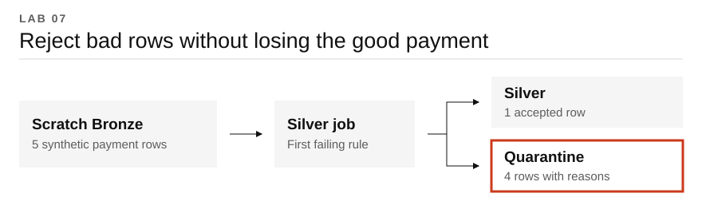

# Lab 07 · Quality checks and quarantine

**Time:** 60 minutes. **Starting point:** [Lab 06 complete](lab-06-lakehouse.md), with the core stack running. Use one Bash terminal at the repository root. Use only synthetic payment data.

## Goal

Run the silver job against a clean payment and four faulty payments. Read the rejection reasons, recover the clean batch, and propose a gate that stops bad batches before publication.



## Playbook

### 1. Find the checks and isolate the run

Open [`spark/jobs/silver_transactions.py`](../../spark/jobs/silver_transactions.py). Find the first four rules in `CHECKS`. Trace how rule order selects one `reject_reason` and how the job appends rejected rows to quarantine. Find what happens when there are no accepted rows.

Define the commands for your environment. All remaining blocks are shared.

**Codespaces**

```bash
spark_run() { /opt/spark/bin/spark-submit "$@"; }
store() { mc "$@"; }
```

**Compose only**

```bash
spark_run() { docker compose exec -T spark-master /opt/spark/bin/spark-submit "$@"; }
store() { docker compose exec -T minio-client mc "$@"; }
```

Create a scratch runner under the mounted jobs directory. It runs the real job against separate Bronze, Silver, and quarantine paths. It does not edit existing scripts or tables.

```bash
WORK=$(mktemp -d spark/jobs/lab07-XXXXXX)
RUN=${WORK##*/}
APP="/opt/spark-apps/$RUN/quality.py"
BRONZE="local/bronze/$RUN/transactions"
cat > "$WORK/quality.py" <<'PY'
import runpy
import sys
from pathlib import Path

here = Path(__file__).resolve().parent
sys.path.insert(0, str(here.parent))
import common

common.BRONZE_TRANSACTIONS = f"s3a://bronze/{here.name}/transactions/"
common.SILVER_TRANSACTIONS = f"s3a://silver/{here.name}/transactions/"
common.QUARANTINE_TRANSACTIONS = f"s3a://quarantine/{here.name}/transactions/"
if sys.argv[1:] == ["inspect"]:
    spark = common.session("lab07_inspect")
    rows = common.read_delta(spark, common.QUARANTINE_TRANSACTIONS)
    rows.groupBy("reject_reason").count().orderBy("reject_reason").show()
    rows.select("transaction_id", "passenger_id", "airport", "amount", "hour_of_day",
                "reject_reason").orderBy("transaction_id").show(truncate=False)
    spark.stop()
else:
    runpy.run_path(str(here.parent / "silver_transactions.py"), run_name="__main__")
PY
printf 'Quality run: %s\n' "$RUN"
```

### 2. Establish the clean count

Upload one synthetic payment. Run the job before injecting faults so you have a recovery baseline.

```bash
HEADER=$(head -n 1 data/raw/transactions.csv)
{
  printf '%s\n' "$HEADER"
  printf '%s\n' 'lab07-clean,41,2026-11-18T10:00:00+00:00,LIS,lounge,25.0,10,0,1,30.0'
} | store pipe "$BRONZE/clean.csv"
spark_run "$APP"
```

**Checkpoint:** record the summary. It should show `bronze=1 silver=1 rejected=0`.

### 3. Inject the four faults and read the quarantine

```bash
{
  printf '%s\n' "$HEADER"
  cat <<'CSV'
900001,,2026-11-18T10:00:00+00:00,LIS,lounge,25.0,10,0,1,30.0
900002,42,2026-11-18T10:05:00+00:00,XXX,lounge,25.0,10,0,1,30.0
900003,43,2026-11-18T10:07:00+00:00,LIS,food_beverage,-4.5,10,0,1,20.0
900004,44,2026-11-18T10:09:00+00:00,LIS,food_beverage,12.0,27,0,1,20.0
CSV
} | store pipe "$BRONZE/faulty.csv"
spark_run "$APP"
spark_run "$APP" inspect
```

**Checkpoint:** the summary should show `bronze=5 silver=1 rejected=4`. Match IDs `900001`–`900004` to `NULL_KEY`, `UNKNOWN_AIRPORT`, `NON_POSITIVE_AMOUNT`, and `BAD_HOUR`. Save the job summary and both inspection tables. Do not rerun the faulty batch for evidence: quarantine is append-only, so each rerun adds another set of rejects.

### 4. Remove the fault and confirm recovery

Remove only your scratch fault object. Rebuild the scratch silver table. Reopen quarantine to confirm the rejection evidence survived.

```bash
store rm "$BRONZE/faulty.csv"
spark_run "$APP"
spark_run "$APP" inspect
```

**Checkpoint:** compare the new summary with the baseline. Silver has the original accepted count and no new rejects; quarantine still shows the four rejects. Remove the helper when finished; the isolated Delta evidence stays in MinIO.

```bash
rm "$WORK/quality.py"
rmdir "$WORK"
```

### 5. Choose a publication gate

Propose a rejection-rate threshold and denominator. State which side of the threshold stops publication, who gets notified, and whether an operator can override it. Explain how you would handle retries without counting duplicate quarantine rows as new rejects.

Read `quality_gate` in [`flows/pipeline.py`](../../flows/pipeline.py). Compare its input metric, dependency on labels, and position after scoring with your proposed pre-publication check. A failed flow does not roll back outputs already written by earlier tasks.

## Output evidence to submit

Submit `lab-07-evidence.md` with your environment, run ID, and actual results.

| Evidence | What it must show |
|---|---|
| Baseline and faulty batch | Both job summaries and the four checks you traced in code. |
| Quarantine | Count by reason and one payment ID for each reason. |
| Recovery | The restored clean count and the surviving quarantine evidence. |
| Gate design | Rejection threshold, denominator, action, owner, and a comparison with the flow's precision gate. |

Next: [Lab 08 · A live passenger blocklist](lab-08-cdc.md).
