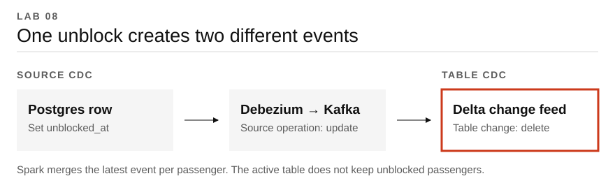

# Lab 08 · A live passenger blocklist

**Time:** 60 minutes. **Starting point:** [Lab 07 complete](lab-07-data-quality.md). Keep the generated payments and Delta features from Labs 04–06. Use one Bash terminal at the repository root. Use only synthetic data.

## Goal

Capture a Postgres block and unblock with Debezium. Merge each change into a Delta blocklist, score one day's payments, and use Delta to recover an earlier list.



## Codespace playbook

### 1. Start CDC and allocate an isolated run

```bash
scripts/codespace.sh up cdc
pg() { psql -v ON_ERROR_STOP=1 -U postgres -d airport "$@"; }
kafka_tool() { local tool=$1; shift; "/opt/kafka/bin/$tool.sh" "$@"; }
spark_run() { /opt/spark/bin/spark-submit "$@"; }
```
Check the stack and record the run ID. Each run uses its own table, topic, connector, slot, publication, blocklist, and batch-score output.

```bash
scripts/services.sh smoke
spark_run /opt/spark-apps/smoke_delta.py
WORK=$(mktemp -d spark/jobs/lab08_XXXXXX)
RUN=$(printf '%s' "${WORK##*/}" | tr '[:upper:]' '[:lower:]')
TABLE="passenger_blocklist_$RUN"
TOPIC="$RUN.public.$TABLE"
CONNECT=http://localhost:8083/connectors
APP="/opt/spark-apps/${WORK##*/}/cdc_run.py"
printf 'Run: %s\nTopic: %s\n' "$RUN" "$TOPIC"
```

**Checkpoint:** check that Postgres and Kafka Connect are healthy and the Delta smoke job succeeds. The smoke job uses its own table, not the blocklist.

### 2. Create the blocklist source and register Debezium

Use the checked-in [SQL](../../cdc/blocklist.sql) and [connector config](../../cdc/blocklist-connector.json) with run-specific names. The SQL seeds one active block for synthetic passenger `7`.

```bash
kafka_tool kafka-topics --bootstrap-server kafka:9092 --create --topic "$TOPIC" \
  --partitions 1 --replication-factor 1 --config retention.ms=-1
python3 - "$TABLE" <<'PY' | pg -q
import sys
from pathlib import Path

print(Path("cdc/blocklist.sql").read_text().replace("passenger_blocklist", sys.argv[1]))
PY
python3 - "$RUN" "$TABLE" <<'PY' | curl -fsS -X PUT -H 'Content-Type: application/json' --data-binary @- "$CONNECT/$RUN/config"
import json
import sys
from pathlib import Path

run, table = sys.argv[1:]
config = json.loads(Path("cdc/blocklist-connector.json").read_text())["config"]
config.update({
    "topic.prefix": run,
    "table.include.list": f"public.{table}",
    "slot.name": run,
    "slot.drop.on.stop": "true",
    "publication.name": run,
    "schema.history.internal.kafka.topic": f"schemahistory.{run}",
})
print(json.dumps(config))
PY
curl -fsS "$CONNECT/$RUN/status"
```

**Checkpoint:** repeat the status command until the connector and its task both report `RUNNING`. If a task reports `FAILED`, read its `trace` before continuing. Do not drop another connector's replication slot.

Define this Kafka read and run it at each capture checkpoint. It starts from the beginning; an inactivity timeout after the records is normal. Alternatively, open port `8080` (Kafbat UI) and open **Topics → your run topic → Messages**.

```bash
read_cdc() {
  kafka_tool kafka-console-consumer --bootstrap-server kafka:9092 \
    --topic "$TOPIC" --from-beginning --timeout-ms 5000 \
    --property print.offset=true --property print.key=true
}
read_cdc
```

**Checkpoint:** wait for passenger `7` with `__op: "r"` (snapshot read). Record the key, operation, and Kafka offset. Spark cannot merge a change that has not reached Kafka yet.

### 3. Build the active Delta list

Create a launcher for the existing Spark jobs. It substitutes only the input topic and output paths for this run. It leaves the usual Silver payments and Gold features as read-only inputs.

```bash
cat > "$WORK/cdc_run.py" <<'PY'
import runpy
import sys
from pathlib import Path

here = Path(__file__).resolve().parent
sys.path.insert(0, str(here.parent))
import common

run = here.name.lower()
common.SILVER_BLOCKLIST = f"s3a://silver/{run}/blocklist/"
common.GOLD_SCORES = f"s3a://gold/{run}/fraud_scores/"
job = here.parent / sys.argv.pop(1)
if job.name == "blocklist_from_cdc.py":
    original = '"fraud.public.passenger_blocklist"'
    source = job.read_text()
    if source.count(original) != 1:
        raise SystemExit("Cannot find the blocklist job's topic literal.")
    topic = f'"{run}.public.passenger_blocklist_{run}"'
    exec(compile(source.replace(original, topic), str(job), "exec"),
         {"__name__": "__main__", "__file__": str(job)})
else:
    runpy.run_path(str(job), run_name="__main__")
PY
spark_run "$APP" blocklist_from_cdc.py
spark_run "$APP" blocklist_changes.py
```

**Checkpoint:** note the creation message, active count of `1`, and passenger `7`'s `insert` commit version. Debezium read a source snapshot; Delta recorded an insert into a new table. Those are distinct events.

### 4. Score a day with passenger 7

Use the latest generated day with a payment by passenger `7`. If no day prints, use the synthetic dataset from Labs 04–06 that includes this passenger before continuing. Do not regenerate over existing raw data for this exercise.

```bash
DAY=$(awk -F, '$2 == 7 {d=substr($3,1,10); if (d > latest) latest=d} END {print latest}' data/raw/transactions.csv)
printf 'Scoring day: %s\n' "$DAY"
```

```bash
spark_run "$APP" score_batch.py --date "$DAY"
spark_run "$APP" blocked_payments.py 7 --date "$DAY"
```

**Checkpoint:** the displayed payments include `BLOCKED_PASSENGER` and `is_alert=true`. The list adds 100 points to each matching payment. This is a replay using the current list, not an event-time join against the historical list.

### 5. Add passenger 42 and identify the Delta insert

```bash
pg -c "INSERT INTO public.$TABLE (passenger_id, reason, blocked_at) VALUES (42, 'synthetic stolen card report', (extract(epoch from clock_timestamp()) * 1000)::bigint);"
read_cdc
```

**Checkpoint:** repeat `read_cdc` until the passenger `42` event has `__op: "c"` and `unblocked_at: null`. Save its offset, then merge the block.

```bash
spark_run "$APP" blocklist_from_cdc.py
spark_run "$APP" blocklist_changes.py
```

**Checkpoint:** there are two active passengers. Record the `_commit_version` of passenger `42`'s `insert`. Do not assume it is the same number as the Kafka offset.

### 6. Unblock passenger 42 and compare the two feeds

```bash
pg -c "UPDATE public.$TABLE SET unblocked_at = (extract(epoch from clock_timestamp()) * 1000)::bigint WHERE passenger_id = 42;"
read_cdc
```

**Checkpoint:** repeat `read_cdc` until passenger `42` has a later `__op: "u"` event with non-null `unblocked_at`. Merge after that event appears.

```bash
spark_run "$APP" blocklist_from_cdc.py
spark_run "$APP" blocklist_changes.py
```

**Checkpoint:** the active count returns to `1`. Passenger `42` is still a row in Postgres, but this source update is a Delta `delete` because the Delta table holds only active blocks. Record the delete commit version.

### 7. Time travel and close the run

When prompted, enter the Delta commit version that inserted passenger `42`, then the version that deleted that row.

```bash
read -r -p 'Delta insert version for passenger 42: ' INSERT_VERSION
read -r -p 'Delta delete version for passenger 42: ' DELETE_VERSION
spark_run "$APP" blocklist_version.py "$INSERT_VERSION"
spark_run "$APP" blocklist_version.py "$DELETE_VERSION"
```

**Checkpoint:** the first snapshot contains passengers `7` and `42`. The second contains only `7`. After saving evidence, stop your connector before dropping its source objects. The connector is configured to release its own replication slot on stop. Keep Kafka and Delta history as evidence, and leave the core stack running.

```bash
curl -fsS -X DELETE "$CONNECT/$RUN" &&
  pg -c "DROP PUBLICATION IF EXISTS $RUN; DROP TABLE public.$TABLE;" &&
  rm "$WORK/cdc_run.py" && rmdir "$WORK"
```

## Laptop (Docker) playbook

Use the complete Codespace playbook above. In Step 1, start the CDC profile and define these wrappers instead:

```bash
docker compose --profile cdc up -d --wait
pg() { docker compose exec -T postgres psql -v ON_ERROR_STOP=1 -U postgres -d airport "$@"; }
kafka_tool() { local tool=$1; shift; docker compose exec -T kafka "/opt/kafka/bin/$tool.sh" "$@"; }
spark_run() { docker compose exec -T spark-master /opt/spark/bin/spark-submit "$@"; }
```

All remaining commands, checkpoints, and evidence requirements are unchanged.

## Output evidence to submit

Submit `lab-08-evidence.md` with your environment, run ID, topic, and actual results.

| Evidence | What it must show |
|---|---|
| Source CDC | Connector and task `RUNNING`; passenger `7`'s snapshot; passenger `42`'s block and unblock, with offsets. |
| Scoring | The selected day and passenger `7`'s displayed scores, rule codes, and alert flags. |
| Delta CDF | Active counts and the commit versions for passenger `42`'s `insert` and `delete`. |
| Time travel | Both snapshots, labeled with the versions you read. |

Explain why the job chooses the highest Kafka offset per passenger and what keeping the first event would do after an unblock. For a block at 10:00 that must affect payments by 10:01, budget time for source capture, Kafka delivery, the merge, and the scorer's list refresh. Name the first step you would automate and why.

Next: [Lab 09 · Test and tune the rules](lab-09-ci-cd.md).
