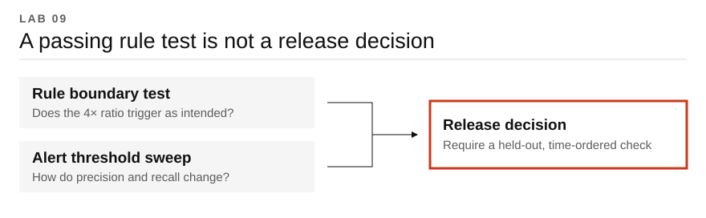

# Lab 09 · Test and tune the rules

**Time:** 45 minutes. **Starting point:** [Lab 08 complete](lab-08-cdc.md), with `data/raw/transactions.csv` and `data/raw/labels.csv` from the same synthetic batch. Use one Bash terminal at the repository root. Commands are identical in Codespaces and on a laptop. No service is required for this lab.

## Goal

See a boundary test stop a rule regression. Add two behavior checks, measure an alert-threshold trade-off, and decide what the current pull-request workflow should test next.



## Playbook

### 1. Run the same tests as CI

```bash
uv sync --locked
PYTHONPATH=src uv run --locked python -m pytest tests -q
```

Read the names in [`tests/test_fraud_rules.py`](../../tests/test_fraud_rules.py) and the flag conditions in [`spark/jobs/fraud_rules.py`](../../spark/jobs/fraud_rules.py).

**Checkpoint:** save the passing baseline output. If it fails, resolve the baseline problem before adding the fault. Identify the test that checks both sides of the 4× amount boundary.

### 2. Break the rule in a scratch copy

Copy the current sources, not the last commit. Keep the original rule file inside the scratch directory for restoration. Nothing below writes to the repository's rule or test files, changes the index, or alters generated data.

```bash
ROOT=$PWD
WORK=$(mktemp -d)
mkdir -p "$WORK/spark/jobs"
cp -R tests schemas src "$WORK/"
cp spark/jobs/fraud_rules.py "$WORK/spark/jobs/fraud_rules.py"
cp "$WORK/spark/jobs/fraud_rules.py" "$WORK/fraud_rules.baseline"
run_tests() { (cd "$WORK" && PYTHONPATH=src "$ROOT/.venv/bin/python" -m pytest tests -q); }
printf 'Scratch copy: %s\n' "$WORK"
```

Lower only the amount-ratio trigger from 4× to 2×. Do not change `ALERT_THRESHOLD`; that is the cutoff on the total score.

```bash
python3 - "$WORK/spark/jobs/fraud_rules.py" <<'PY'
import sys
from pathlib import Path

path = Path(sys.argv[1])
text = path.read_text()
old = 'out["amount_ratio"] >= 4,'
if text.count(old) != 1:
    raise SystemExit("Expected a single unchanged 4x predicate in the scratch copy.")
path.write_text(text.replace(old, 'out["amount_ratio"] >= 2,'))
PY
run_tests || printf 'pytest exit code: %s\n' "$?"
```

**Checkpoint:** capture the failed test name and assertion. Calculate the ratio for the row that now fires incorrectly. An environmental error is not evidence of a caught regression.

Restore only the scratch file and confirm that it passes again.

```bash
cp "$WORK/fraud_rules.baseline" "$WORK/spark/jobs/fraud_rules.py"
run_tests
```

### 3. Add two behavior tests

Use `score_one` and its `base` fixture in the scratch copy. Make the inputs under test explicit. Run the food-counter case first.

```bash
cat >> "$WORK/tests/test_fraud_rules.py" <<'PY'


def test_card_present_food_purchase_at_13_scores_zero():
    row = score_one(merchant_category="food_beverage", hour_of_day=13,
                    card_present=1, amount=10.0)
    assert row["score"] == 0
PY
run_tests
```

Add the second case. Keep the amount below the spike cutoff and the departure time outside the last-minute window so those rules cannot hide a missing signal.

```bash
cat >> "$WORK/tests/test_fraud_rules.py" <<'PY'


def test_night_electronics_without_card_combines_signals():
    row = score_one(merchant_category="electronics", hour_of_day=3,
                    event_timestamp="2024-01-15T03:00:00Z", card_present=0,
                    amount=10.0, minutes_to_departure=120.0)
    assert {"NIGHT_PAYMENT", "CARD_NOT_PRESENT_HIGH_RISK"} <= set(row["rules"].split(","))
    assert row["score"] >= 35
PY
run_tests
```

**Checkpoint:** save the passing output with both tests. Explain what zero points protects and why checking both rule codes is stronger than checking the total alone. A score of 35 need not be an alert.

### 4. Sweep thresholds against the synthetic labels

Create a scratch tuning script. Its whole-history features are simpler than the Spark pipeline's point-in-time features. They include future payments relative to the payment being scored, so treat the sweep as exploratory, not release validation.

```bash
cat > "$WORK/tune.py" <<'PY'
import sys
from pathlib import Path

import pandas as pd

sys.path.insert(0, str(Path(__file__).resolve().parent / "spark" / "jobs"))
import fraud_rules as fr

raw = Path(sys.argv[1])
payments = pd.read_csv(raw / "transactions.csv")
labels = pd.read_csv(raw / "labels.csv")
df = payments.merge(labels, on="transaction_id", validate="one_to_one")
if not len(df) == len(payments) == len(labels) or df.empty:
    raise SystemExit("Use matching nonempty synthetic payment and label files.")
by_passenger = df.groupby("passenger_id")
df["avg_amount_30d"] = by_passenger["amount"].transform("mean")
df["distinct_airports_30d"] = by_passenger["airport"].transform("nunique")
df["account_age_days"] = 365.0
df["blocked"] = False
scored = fr.score_frame(df)
print(f"payments={len(scored)} fraud_labels={int(scored.is_fraud.sum())}")
for threshold in (30, 40, 50, 60, 70):
    alerts = scored["score"] >= threshold
    fraud = scored["is_fraud"] == 1
    tp = int((alerts & fraud).sum())
    fp = int((alerts & ~fraud).sum())
    fn = int((~alerts & fraud).sum())
    precision = f"{tp / (tp + fp):.2f}" if tp + fp else "n/a"
    recall = f"{tp / (tp + fn):.2f}" if tp + fn else "n/a"
    print(f"threshold={threshold:>3} alerts={tp+fp:>6} TP={tp} FP={fp} FN={fn} "
          f"precision={precision} recall={recall}")
PY
"$ROOT/.venv/bin/python" "$WORK/tune.py" "$ROOT/data/raw"
```

**Checkpoint:** save all five rows. If a denominator is zero, report the `n/a` and why. Compare your chosen threshold with the current 50-point cutoff. Explain who bears the cost of a false positive and who bears the cost of missed fraud. Name the held-out, time-ordered check you would require before shipping.

### 5. Read the pull-request workflow

```bash
cat .github/workflows/ci.yml
```

List the paths that trigger `lab-ci` and the actual setup and test commands. Explain the effect of pytest failure on the check. A failed check blocks merge only when repository rules require it; the workflow file does not configure that policy. Identify one failure the host suite would miss in a Spark job. Propose an integration check, name the fixture and pass condition, and explain the expected CI time cost.

Keep your scratch directory until you have saved your test code and output. Do not copy the deliberately broken rule into the repository. Leave the platform ready for the next lab.

## Output evidence to submit

Submit `lab-09-evidence.md` with your environment and actual results.

| Evidence | What it must show |
|---|---|
| CI baseline and deliberate break | Passing baseline, failed boundary assertion, ratio calculation, and passing restoration. |
| Added tests | Both test bodies, final passing result, and the purpose of each assertion. |
| Threshold decision | Full sweep, your chosen cutoff compared with 50, and who pays for each error. |
| Workflow analysis | Paths, commands, failure and merge-policy distinction, plus one proposed Spark check and its CI cost. |

Next: [Lab 10 · Monitor the pipeline](lab-10-observability.md).
