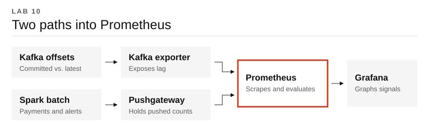

# Lab 10 · Monitor the fraud pipeline

**Time:** 60 minutes. **Starting point:** Labs 05 and 06 complete, including the silver payments and gold features. Run terminal commands from the lab repository root. Keep forwarded ports private.

## Goal

Measure consumer lag and batch alert rate. Follow a lag alert from pending to firing, build two Grafana panels, and add a batch freshness rule.



## Playbook

### 1. Start monitoring and check the scrape targets

**Codespaces**

```bash
scripts/codespace.sh up monitoring
```

**Compose only**

```bash
docker compose --profile monitoring up -d --wait
```

Open port **9090** via the Codespaces **Ports** tab and append `/targets`. On a laptop, open `http://localhost:9090/targets`. Wait for both `kafka` and `pushgateway` to show `UP`. This checks collection, not whether scoring works.

### 2. Create a private exercise topic and commit offsets

Use a fresh topic and group so the running fraud stream and previous Kafka data stay untouched. Define these helpers in the same shell for the rest of the exercise.

**Codespaces**

```bash
kafka_cli() { "/opt/kafka/bin/kafka-$1.sh" "${@:2}"; }
```

**Compose only**

```bash
kafka_cli() { docker compose exec -T kafka "/opt/kafka/bin/kafka-$1.sh" "${@:2}"; }
```

**Both environments**

```bash
TOPIC="lab10-lag-$(date +%s)-$$"
GROUP="$TOPIC"
printf 'Topic: %s; group: %s\n' "$TOPIC" "$GROUP"
kafka_cli topics --bootstrap-server kafka:9092 --create --topic "$TOPIC" --partitions 3 --replication-factor 1
produce_demo() {
  TOPIC="$TOPIC" TRANSACTIONS_PER_SECOND="$1" PYTHONPATH=src uv run --locked python - --seconds "$2" <<'PY'
import os
from lab import config, producer

config.TOPIC_TRANSACTIONS = os.environ['TOPIC']
producer.main()
PY
}
consume_demo() {
  kafka_cli console-consumer --bootstrap-server kafka:9092 --topic "$TOPIC" --group "$GROUP" --from-beginning --timeout-ms 10000 --consumer-property enable.auto.commit=true --consumer-property auto.commit.interval.ms=1000 >/dev/null
}
produce_demo 5 10
consume_demo
kafka_cli consumer-groups --bootstrap-server kafka:9092 --group "$GROUP" --describe
```

**Checkpoint:** the consumer stops after ten seconds without records. An inactivity timeout message is expected. Verify that all three partitions have numeric committed offsets before continuing. Spark stores its streaming offsets in a checkpoint; this separate consumer commits offsets to Kafka so the exporter can measure lag.

### 3. Raise lag, let the alert fire, and drain the backlog

In Prometheus **Query**, graph the following expression. Replace the `LAB_TOPIC` text with the printed topic name. The same name identifies your group.

```promql
sum by (consumergroup, topic) (kafka_consumergroup_lag{topic="LAB_TOPIC"})
```

With the consumer stopped, add enough payments to cross the configured threshold. Use the time while the alert is pending to read the three rules on `/alerts`.

```bash
produce_demo 20 85
kafka_cli consumer-groups --bootstrap-server kafka:9092 --group "$GROUP" --describe
```

**Checkpoint:** sum the partition lag values. If the total is at or below 1,000, run `produce_demo 20 30`, then check again. Find the `ConsumerLagHigh` instance with your topic label on `/alerts`. Keep the consumer stopped until the expression has been true for two minutes plus the next evaluation. Record the times when you see **Pending** and **Firing**. A Prometheus firing state does not mean a notification was sent.

```bash
consume_demo
kafka_cli consumer-groups --bootstrap-server kafka:9092 --group "$GROUP" --describe
```

**Checkpoint:** offsets advance and lag drops. Allow another scrape and rule evaluation for Prometheus to show the decline and clear the alert. Save the graph with both the rise and fall. If lag remains, rerun `consume_demo` and verify offsets again.

### 4. Push batch counts without replacing previous scores

Run the normal scoring job with only its output path redirected to a fresh Delta table. It still reads the existing silver data and features. Keep the scoring day's counts and compare them with the values in Prometheus.

```bash
mkdir -p data/processed
cat > "data/processed/$TOPIC.py" <<'PY'
import runpy
import sys

sys.path.insert(0, '/opt/spark-apps')
import common

common.GOLD_SCORES = f's3a://gold/{sys.argv.pop(1)}/fraud_scores/'
runpy.run_path('/opt/spark-apps/score_batch.py', run_name='__main__')
PY
```

**Codespaces**

```bash
PUSHGATEWAY_URL=http://localhost:9091 /opt/spark/bin/spark-submit "/opt/spark-data/processed/$TOPIC.py" "$TOPIC"
```

**Compose only**

```bash
docker compose exec -T spark-master /opt/spark/bin/spark-submit "/opt/spark-data/processed/$TOPIC.py" "$TOPIC"
```

**Checkpoint:** record the `scored day=…` line. After the next scrape, query `fraud_batch_payments`, `fraud_batch_alerts`, and `fraud_batch_alerts / fraud_batch_payments`. Match the `day` label to the scoring log. Explain why the fraction of payments flagged is not precision. If the series is missing, inspect `curl -fsS http://localhost:9091/metrics | grep fraud_batch` and check the target again.

### 5. Interpret the rules and save a Grafana dashboard

On `/alerts`, find `ConsumerLagHigh`, `NoAlertsWhileTrafficFlows`, and `BatchAlertRateHigh`. Record each expression, its `for` interval, and the first check you would perform. Distinguish a dead scorer from a healthy period with few fraud alerts.

Open port **3000** in Codespaces, or `http://localhost:3000` on a laptop. Sign in with the training credentials `admin` / `admin`. If prompted to change the password, keep the service private and do not record the password in your evidence.

1. Go to **Dashboards → New → New dashboard → Add visualization**. Select **Prometheus**.
2. Choose **Time series**. Switch the query editor to **Code** and enter the step 3 query for your topic. Name the panel **Demo consumer lag**.
3. Return to the dashboard. Add a second **Time series** panel with `fraud_batch_alerts / fraud_batch_payments`. Name it **Batch alert rate**. Use a fraction or select a percent unit for values from 0 to 1.
4. Set the time range to **Last 30 minutes** or wider if needed. Save the dashboard with your topic name. Use **Export → Export as JSON** and save the file, or take a screenshot of both panels.

**Checkpoint:** the lag panel shows the backlog and drain. The batch panel agrees with the scoring log for the current day label. Change the time range and refresh before changing the queries if a panel appears empty.

### 6. Add a batch freshness alert and restore the original config

The pushed counts can remain after the batch stops. Add a rule that measures time since the last successful push. Also match a missing series, but only interpret that branch after confirming the target is healthy.

```bash
RULES=monitoring/prometheus/alerts.yml
BACKUP=$(mktemp)
cp "$RULES" "$BACKUP"
cat >> "$RULES" <<'YAML'
  - name: lab10-freshness
    rules:
      - alert: BatchMetricsStale
        expr: (time() - push_time_seconds{job="fraud_batch"} >= 86400) or absent(push_time_seconds{job="fraud_batch"})
        labels: {severity: warning}
        annotations:
          summary: "No observed fraud batch push in the last 24 hours"
YAML
```

**Codespaces**

```bash
scripts/codespace.sh restart prometheus
```

**Compose only**

```bash
docker compose --profile monitoring restart prometheus
```

**Checkpoint:** `/alerts` lists `BatchMetricsStale`. Query `time() - push_time_seconds{job="fraud_batch"}` to check the age in seconds. A recent push should keep the rule inactive; do not wait a day to test it. If the rule fails to load, inspect the Prometheus logs and restore the backup before proceeding.

```bash
cp "$BACKUP" "$RULES"
```

Repeat your environment's restart command. Confirm the training rule is gone and both scrape targets are `UP`. Leave the core stack running. Do not delete topics, checkpoints, or score tables from prior labs.

## Output evidence to submit

Submit one `lab-10-evidence.md` with your environment, topic/group, and observed results.

| Evidence | What it must show |
|---|---|
| Targets | Screenshot or output showing both jobs `UP`. |
| Lag and alert | Graph with rise and fall, offset/lag totals, and observed pending and firing times. |
| Batch | Scoring log, Prometheus counts and ratio for the same day, and what the ratio means. |
| Rule review | All three existing conditions, hold times, and one first action per rule. |
| Dashboard and freshness | Two Grafana panels (screenshot or attached JSON), the added rule, its loaded state, and why push age is a better signal than counts alone. |

Next: [Lab 11 · Orchestrate the daily pipeline](lab-11-orchestration.md).
