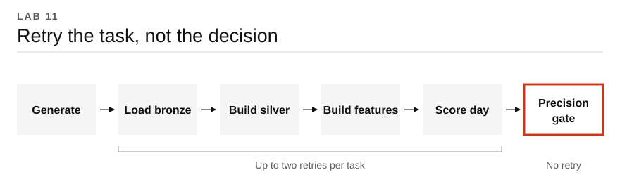

# Lab 11 · Orchestrate the daily pipeline

**Time:** 60 minutes. **Starting point:** Labs 04–06 complete. Run commands from the lab repository root. Finish each run before starting another. Keep all forwarded ports private.

## Goal

Run the six-task batch flow in Prefect. Observe a successful retry and a failed precision gate. Serve the daily deployment and send an alert to a local receiver.



## Playbook

### 1. Start Prefect and prepare an isolated run

**Codespaces**

```bash
scripts/codespace.sh up orchestration
```

**Compose only**

```bash
docker compose --profile orchestration up -d --wait
```

```bash
export PREFECT_API_URL=http://localhost:4200/api
curl -fsS "$PREFECT_API_URL/health"
```

Open port **4200** via the Codespaces **Ports** tab. On a laptop, open `http://localhost:4200`. Leave the other services running.

The stock flow regenerates CSV files and overwrites feature snapshots. Make an exercise copy that uses fresh paths for all writes. The copy keeps the stock tasks and their dependencies. It skips the optional CDC blocklist by pointing to an unused path and does not replace the Lab 10 metrics.

```bash
umask 022
mkdir -p data/processed
WORK=$(mktemp -d "$PWD/data/processed/lab11-XXXXXX")
chmod 755 "$WORK"
LAB=$(basename "$WORK")
python3 - "$WORK" <<'PY'
import re
import shutil
import sys
from pathlib import Path

root = Path.cwd()
work = Path(sys.argv[1])
name = work.name
spark_work = f'/opt/spark-data/processed/{name}'
mc_work = f'/data/processed/{name}'
report = f'/tmp/{name}-evaluation.json'
shutil.copy2(root / 'params.yaml', work / 'params.yaml')
for job in ('common.py', 'silver_transactions.py', 'features_30d.py', 'score_batch.py', 'evaluate.py'):
    text = (root / 'spark/jobs' / job).read_text()
    if job == 'common.py':
        text = re.sub(r's3a://(bronze|silver|gold|quarantine)/', rf's3a://\1/{name}/', text)
        text = text.replace('/opt/spark-data/raw/labels.csv', f'{spark_work}/data/raw/labels.csv')
        text = text.replace('/tmp/airport-evaluation.json', report)
    (work / job).write_text(text)

flow = (root / 'flows/pipeline.py').read_text()
flow = flow.replace('Path(__file__).resolve().parents[1]', f'Path({str(root)!r})')
flow = flow.replace('"PYTHONPATH": "src"', f'"PYTHONPATH": "src", "LAB_ROOT": {str(work)!r}')
flow = flow.replace('/data/raw/', f'{mc_work}/data/raw/')
flow = flow.replace('local/bronze/', f'local/bronze/{name}/')
flow = flow.replace('/opt/spark-apps/{job}', f'{spark_work}/{{job}}')
flow = flow.replace('/tmp/airport-evaluation.json', report)
flow = flow.replace('data/reports', f'data/processed/{name}/reports')
flow = flow.replace('airport-payments-daily', f'airport-payments-daily-{name}')
flow = flow.replace('airport-payments-0600', f'airport-payments-0600-{name}')
flow = flow.replace('"spark-master"] if ON_DOCKER', '"-e", "PUSHGATEWAY_URL=", "spark-master"] if ON_DOCKER', 1)
flow = flow.replace('**os.environ, "PYTHONPATH"', '**os.environ, "PUSHGATEWAY_URL": "", "PYTHONPATH"')
# When armed, cause a single Spark submission to fail before writing data.
flow = flow.replace('    return run([*SPARK_SUBMIT,', f'''    fault = Path({str(work / 'fail-once')!r})
    if job == 'silver_transactions.py' and fault.exists():
        fault.unlink()
        return run([*SPARK_SUBMIT, '--properties-file', '/tmp/{name}-missing.conf', {spark_work!r} + '/' + job])
    return run([*SPARK_SUBMIT,''')
(work / 'pipeline.py').write_text(flow)
print(f'Flow: airport-payments-daily-{name}')
print(f'Workspace: {work}')
PY
```

Keep `WORK`, `LAB`, and `PREFECT_API_URL` in this shell. The copied Spark jobs use the same code and still ship the shared fraud rules from `/opt/spark-apps`.

### 2. Run the flow and read the task dependencies

```bash
uv run --locked python "$WORK/pipeline.py"
cat "$WORK/reports/evaluation.json"
```

In Prefect, open **Runs** and select the newest run for `airport-payments-daily-…` with your suffix. Open its graph or task list and record the task order and durations. Compare them with [`flows/pipeline.py`](../../flows/pipeline.py).

**Checkpoint:** `generate_data → load_bronze → build_silver → build_features → score_day → quality_gate`. The gate logs the evaluation day, precision, and threshold outcome. Record the observed status. If the normal gate fails, inspect the report and record why; do not lower the gate or change the fraud rules. To select a day on another run, append an observed `event_date` to the command. With no date, scoring selects the latest day in the generated data.

Identify every task that can retry. Explain why `load_bronze` can retry even though it is not a Spark task. Compare `wait_for` with passing the scoring future into `quality_gate`. Identify both tasks with zero retries and explain why repeating the precision decision would not fix it.

### 3. Make Spark submission fail once, then recover

Arm the temporary trigger and run the flow again. The first silver submission receives a path to a nonexistent properties file. Only that attempt uses the bad path. This simulates a one-attempt launch failure without stopping a shared worker or editing a Spark configuration.

```bash
touch "$WORK/fail-once"
uv run --locked python "$WORK/pipeline.py"
```

**Checkpoint:** open `build_silver` in the latest run. Find the nonzero submission error, the message scheduling the retry, and the successful next attempt. Compare the delay with the configured 30 seconds. Check that subsequent tasks waited for silver. Record observed states even if a later, unrelated task fails. If you interrupt the run before silver starts, remove the armed trigger with `rm -f "$WORK/fail-once"` before continuing.

### 4. Serve the daily deployment

```bash
uv run --locked python "$WORK/pipeline.py" serve
```

Leave the terminal running. In Prefect, open **Deployments** and select `airport-payments-0600-…` with your suffix. Confirm the cron expression `0 6 * * *` and record the displayed timezone. Use **Run** (or **Quick run** in the run menu) with the default parameters. Open the run and wait for its terminal state. Save the schedule and run ID. Stop the runner with Ctrl+C. Check that the schedule is paused; pause just your deployment's schedule if necessary.

### 5. Configure a local failure notification and trip the gate

Use a loopback receiver. No email account, Slack credentials, or public endpoint is needed. Create the receiver from the main shell:

```bash
cat > "$WORK/notify.py" <<'PY'
from http.server import BaseHTTPRequestHandler, HTTPServer

class Receiver(BaseHTTPRequestHandler):
    def do_POST(self):
        if self.path != '/lab11':
            self.send_error(404)
            return
        payload = self.rfile.read(int(self.headers['Content-Length']))
        print(payload.decode(), flush=True)
        self.send_response(204)
        self.end_headers()

print('Listening on 127.0.0.1:8765', flush=True)
HTTPServer(('127.0.0.1', 8765), Receiver).serve_forever()
PY
printf 'LAB=%s\n' "$LAB"
```

Open a second terminal at the repository root. Set `LAB` to the printed value (for example `LAB=lab11-Ab12Cd`). Start the receiver there and leave it running so you can see the incoming POST.

**Codespaces**

```bash
python3 "data/processed/$LAB/notify.py"
```

**Compose only**

```bash
docker compose --profile orchestration cp "data/processed/$LAB/notify.py" "prefect-server:/tmp/$LAB-notify.py"
docker compose --profile orchestration exec prefect-server python "/tmp/$LAB-notify.py"
```

Back in the main shell, create the automation. Its trigger matches only failed runs of your lab flow. The automation makes a POST from the Prefect server to its own loopback interface.

```bash
LAB="$LAB" uv run --locked python - <<'PY'
import os

from prefect.automations import Automation
from prefect.blocks.webhook import Webhook
from prefect.events.actions import CallWebhook
from prefect.events.schemas.automations import EventTrigger

lab = os.environ['LAB']
block = Webhook(url='http://127.0.0.1:8765/lab11', headers={'Content-Type': 'application/json'})
block_id = block.save(f'{lab.lower()}-receiver', overwrite=True)
automation = Automation(
    name=f'{lab}-failed-run',
    trigger=EventTrigger(
        expect={'prefect.flow-run.Failed'},
        match_related={'prefect.resource.role': 'flow', 'prefect.resource.name': f'airport-payments-daily-{lab}'},
    ),
    actions=[CallWebhook(block_document_id=block_id,
                         payload='{"message":"Precision-gate exercise failed","flow_run":"{{ event.resource.id }}"}')],
).create()
print(f'Automation ID: {automation.id}')
PY
LAB_MIN_PRECISION=1.01 uv run --locked python "$WORK/pipeline.py"
```

**Checkpoint:** the command exits nonzero. Confirm that scoring completed and that `quality_gate` failed once, with the measured precision below `1.01`. The receiver should log the failed run ID and `POST /lab11` with HTTP `204`. Match this ID to the failed run; an enabled automation alone does not establish delivery. If no request arrives, inspect the automation's events and verify that the receiver is still running next to the Prefect server.

Disable only your `…-failed-run` automation via the **Automations** page. Stop the local receiver with Ctrl+C after collecting its output. Preserve your isolated report and prior lab data. The gate fails the flow; it does not roll back scores already written by the upstream task.

## Output evidence to submit

Submit one `lab-11-evidence.md` with your environment and isolated flow/deployment names.

| Evidence | What it must show |
|---|---|
| Baseline | Run ID, observed task order and durations, evaluation values, and terminal state. |
| Flow code | Which tasks can retry, which do not retry, and how the two dependency mechanisms differ. |
| Recovery | First silver failure, next attempt, and evidence that dependent tasks waited. |
| Schedule | Cron, timezone, manually triggered deployment run ID and state. |
| Gate and notification | Observed precision, failed gate state, no retry, and matching webhook payload/status. Explain why a failed run is the trigger rather than a task retry. |

Next: [Lab 12 · Govern the payment data](lab-12-governance.md).
