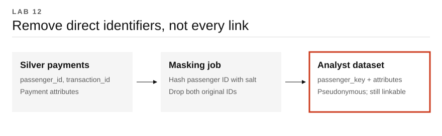

# Lab 12 · Govern the payment data

**Time:** 45 minutes. **Starting point:** Lab 04 complete, with the silver transactions table available. Run commands from the lab repository root. Use only the synthetic training data.

## Goal

Classify payment fields, build and inspect a pseudonymised analyst view, check the contract, map a schema change, and report retention candidates without deleting data.



## Playbook

### 1. Start the stack and classify the fields

**Codespaces**

```bash
scripts/codespace.sh up
spark_lab12() { /opt/spark/bin/spark-submit "$@"; }
```

**Compose only**

```bash
docker compose up -d --wait
spark_lab12() { docker compose exec -T spark-master /opt/spark/bin/spark-submit "$@"; }
```

Read [`contracts/airport-payments.yaml`](../../contracts/airport-payments.yaml). Record the owner and intended consumers. List the `class` and `access` for each classified field. Consider which fields could relate to an identifiable person if these were real payments. Explain why a numeric `passenger_id` can still be personal data. Check what happens if someone can join a transaction reference, timestamp, and airport with another record.

**Checkpoint:** identify at least one field whose privacy implications depend on what else a reader can access. Describe how you would classify and restrict a card number if the source included one. Do not add a card number to the simulator or schema.

### 2. Write a masked dataset to a fresh Delta path

Run the existing masking job against silver. Redirect only its output so an earlier `transactions_masked` table remains untouched. Keep the workspace and table names for the remaining steps.

```bash
umask 022
mkdir -p data/processed
WORK=$(mktemp -d "$PWD/data/processed/lab12-XXXXXX")
chmod 755 "$WORK"
LAB=$(basename "$WORK")
SPARK_WORK="/opt/spark-data/processed/$LAB"
MASKED="s3a://gold/$LAB/transactions_masked/"
cat > "$WORK/run_mask.py" <<'PY'
import runpy
import sys

sys.path.insert(0, '/opt/spark-apps')
import common

common.GOLD_MASKED = sys.argv[1]
runpy.run_path('/opt/spark-apps/mask_payments.py', run_name='__main__')
PY
spark_lab12 "$SPARK_WORK/run_mask.py" "$MASKED"
```

**Checkpoint:** record the destination and `masked rows:` output. A nonzero row count shows that the job processed data. It does not prove that the output conforms to the required column policy.

### 3. Inspect the actual Delta schema and a safe sample

```bash
cat > "$WORK/check_masked.py" <<'PY'
import sys

sys.path.insert(0, '/opt/spark-apps')
from common import read_delta, session
from pyspark.sql import functions as F

spark = session('check_masked')
df = read_delta(spark, sys.argv[1])
print('Columns:', df.columns)
assert {'passenger_id', 'transaction_id'}.isdisjoint(df.columns), 'Direct identifier still present'
assert df.take(1), 'No rows to verify'
key = F.col('passenger_key')
invalid = df.filter(key.isNull() | ~key.rlike('^[0-9a-f]{64}$')).count()
print('Invalid passenger keys:', invalid)
assert invalid == 0, 'Unexpected passenger_key format'
df.select('passenger_key', 'airport', 'amount').show(5, truncate=False)
spark.stop()
PY
spark_lab12 "$SPARK_WORK/check_masked.py" "$MASKED"
```

**Checkpoint:** the stored table has no `passenger_id` or `transaction_id`. The synthetic sample has 64-character hexadecimal keys and the invalid-key count is zero. Do not infer anonymity from that check. A salted hash is not decrypted, but a person who knows the salt can hash candidate IDs and compare the results. Stable keys also allow records to be linked. State who should hold the salt in a real deployment and which controls analysts still need. The training salt in code and shared MinIO login do not enforce production access controls.

### 4. Compare the schema and contract

```bash
PYTHONPATH=src uv run --locked python -m pytest tests -q
uv run --locked python - <<'PY'
import json
from pathlib import Path

import yaml

contract = yaml.safe_load(Path('contracts/airport-payments.yaml').read_text())
schema = json.loads(Path(contract['schema_ref']).read_text())
classified = set(contract['classification'])
defined = set(schema['properties'])
missing = sorted(classified - defined)
print('Classified fields absent from the schema:', missing)
print('Schema fields without explicit classification:', sorted(defined - classified))
if missing:
    raise SystemExit(1)
PY
```

**Checkpoint:** save both results. A stale classification refers to a field absent from the schema. An unclassified schema field is a different coverage issue, not necessarily a schema error. Choose one unclassified field, if present, and propose its class and an access level.

### 5. Assess the impact of a field rename

Search tracked code, tests, configuration, schemas, and documentation. Do not rename any files or fields.

```bash
git grep -n -F merchant_category
```

Group the results by producer, schema/contract, transformation or rule, test, and consumer. For each use, say whether an immediate rename would break it or just leave stale documentation. Note any consumer that code search cannot prove absent, such as an external query on a Delta table.

**Checkpoint:** write a five-step migration plan. Include adding the new field, compatible dual-write or a versioned interface, consumer migration, deprecation, and removal. The current JSON Schema forbids unknown fields. Explain how Registry compatibility checks and versioned consumers affect when you can start sending both names on the wire.

### 6. Report retention candidates without deleting data

Use a strict cutoff: a partition is a candidate when `event_date` is earlier than `as_of - days`. The contract has a **90-day bronze** policy and a **730-day silver** policy. Apply the silver policy to silver. Also run a 90-day what-if on silver to compare with the bronze horizon. That what-if is not permission to delete silver data.

```bash
cat > "$WORK/retention_report.py" <<'PY'
import argparse
import sys
from datetime import date, timedelta

sys.path.insert(0, '/opt/spark-apps')
from common import SILVER_TRANSACTIONS, read_delta, session
from pyspark.sql import functions as F

parser = argparse.ArgumentParser()
parser.add_argument('--as-of', required=True, type=date.fromisoformat)
parser.add_argument('--days', required=True, type=int)
parser.add_argument('--label', required=True)
args = parser.parse_args()
cutoff = args.as_of - timedelta(days=args.days)
spark = session('retention_report')
partitions = read_delta(spark, SILVER_TRANSACTIONS).select('event_date').distinct()
candidates = partitions.where(F.col('event_date') < F.lit(cutoff)).orderBy('event_date').collect()
print(f'{args.label}: as_of={args.as_of} days={args.days} cutoff={cutoff} candidates={len(candidates)}')
for row in candidates:
    print(row.event_date.isoformat())
spark.stop()
PY
AS_OF=$(date -u +%F)
spark_lab12 "$SPARK_WORK/retention_report.py" --as-of "$AS_OF" --days 730 --label silver-policy
spark_lab12 "$SPARK_WORK/retention_report.py" --as-of "$AS_OF" --days 90 --label bronze-horizon-what-if
```

If the second report is empty, use a future reference date to exercise the listing path. This still makes no writes.

```bash
FUTURE=$(python3 -c 'from datetime import datetime, timedelta, timezone; print(datetime.now(timezone.utc).date() + timedelta(days=91))')
spark_lab12 "$SPARK_WORK/retention_report.py" --as-of "$FUTURE" --days 90 --label future-what-if
```

**Checkpoint:** record each cutoff, candidate count, and observed partition dates. An empty list is a valid result. Explain why deletion requires a separate, approved job with audit evidence and checks for holds and downstream dependencies. Explain why removing object-store files directly can invalidate a Delta snapshot. Do not run `DELETE`, `VACUUM`, or `mc rm`.

## Output evidence to submit

Submit one `lab-12-evidence.md` with your environment, masked output path, and actual results. Include only synthetic samples.

| Evidence | What it must show |
|---|---|
| Classification | Field classes and access levels, linkability reasoning, and how card data would be handled. |
| Masking | Stored column list, synthetic sample, invalid-key count, and why a salted key is pseudonymous. |
| Contract | Test result, check in both directions, and any remaining classification gap. |
| Change impact | Affected uses, likely breakages, and a five-step plan that preserves compatibility. |
| Retention | Report dates and candidates for the silver policy and 90-day what-if; why approval and audit belong to a separate deletion job. |

**Course close:** production needs authenticated and encrypted services, managed secrets, access policies on the analyst data, and a controlled processor feed and alert workflow. The local stack does not provide those safeguards.
